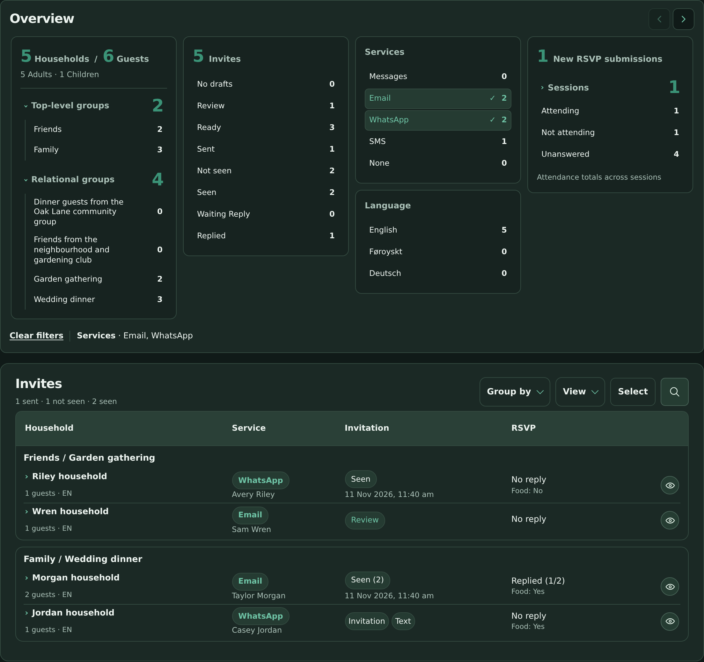
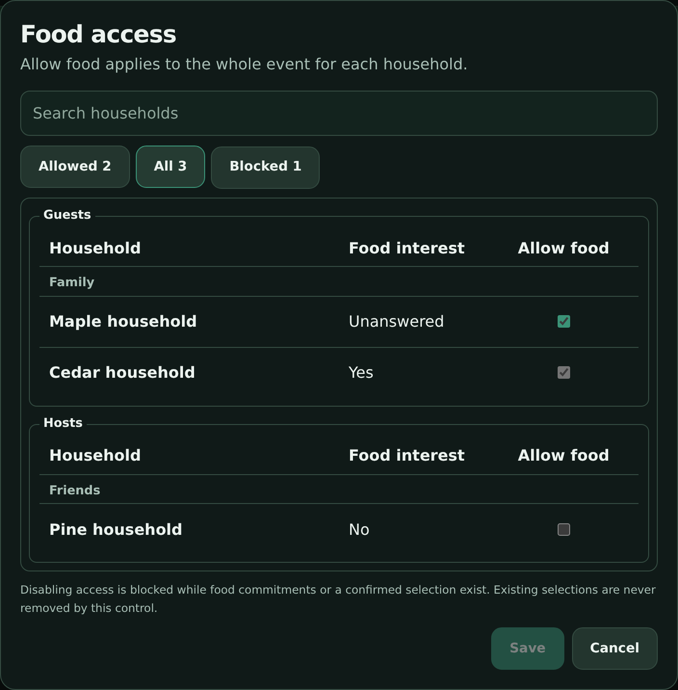
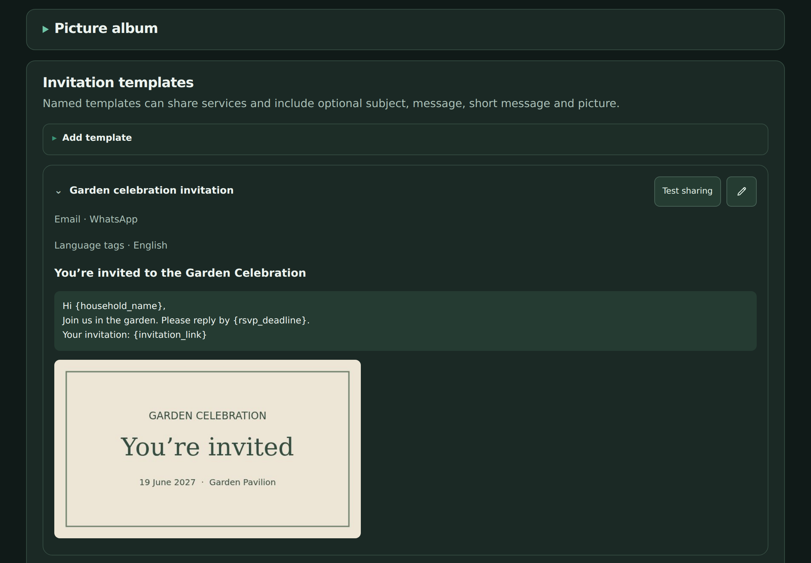

# RSVP Manager

A private invitation and event-planning app for keeping guests, replies, venues, food and practical arrangements together. Designed for use on an iPad as well as a desktop browser.

Guests use their own invitation link. Organizers sign in to manage the event, with access that can be tailored to each administrator.

## Screenshots

A fictional event in Dark mode, shown at iPad landscape width.

### Invites

### Food access

### Templates

## What you can do

- Organize households and individual guests in a nested list.
- Invite different households or guests to different sessions and venues.
- Review and confirm individual replies, then keep the confirmed list visible.
- Collect food interest and manage access in a grouped household dialog before opening category-based choices. Food Groups reserve every included item together without exceeding capacity.
- Open shared read-only recipe dialogs with Print and Close, including printable PDFs.
- Track practical jobs and things to bring in Other.
- Filter households that need a draft and generate selected drafts from service/language-matched templates. Review drafts and move selected invitations between Draft and Ready. Copy recipients and invitations for manual sending, then mark the selected households Sent in the background.
- Follow guest visits, replies and food activity in the Overview while you work. Receive a refresh notice when another administrator changes event data.
- Manage event wording in multiple languages.
- Give administrators Full, View only or Custom access.
- Download Full or selected Partial backups, optionally protect them with password-based encryption, and restart planning on an unpublished installation with a Full safety backup.

## Downloads and installation

Download **[0.10.0](https://github.com/Paetur/RSVP-Manager/releases/tag/v0.10.0)** for the installation ZIP and checksum. The release starts unconfigured, so each installation has its own data. [Installation instructions](INSTALL.md)

Use the current installer for a fresh database. Version 0.10.0 adds organizer corrections for submitted RSVPs, a scrollable Overview and an Event messages editor under Interface settings. For an existing installation, use a reviewed update that preserves existing data and photos. [Existing-installation instructions](INSTALL.md#existing-installations) · [Release notes](docs/ReleaseNotes.md)

For a new cloud project, the [trusted automatic setup companion](docs/AutomaticSetup.md) can perform first-time setup from your own computer. The manual wizard and Studio guides remain available. Encryption usage and requirements are in [Backup encryption](docs/BackupEncryption.md).

Use the [GitHub Pages deployment template](deployment/README.md) to publish a selected release under a path such as `/marriage/`, without downloading ZIP files manually. The workflow does not create a backend or publish your event.

## Start here

**Guests:** use the private link provided by your organizer. See [Replying to an invitation](docs/Guests.md).

**Organizers:** open your installation’s administrator page and sign in. See [Getting started](docs/GettingStarted.md).

**Using your own installation:** open `setup.html` in your installation for the database, administrator and hosting steps. The guides below explain everyday use once that setup is ready.

## User guides

| I want to… | Guide |
|---|---|
| Find my way around and understand View/Edit | [Getting started](docs/GettingStarted.md) |
| Manage people, invitations and replies | [Households and invitations](docs/HouseholdsAndInvites.md) |
| Arrange food, quantities and recipes | [Food and recipes](docs/FoodAndRecipes.md) |
| Track practical jobs and things to bring | [Other](docs/Other.md) |
| Translate event content and change my interface language | [Languages](docs/Languages.md) |
| Add administrators or adjust their access | [Administrators](docs/Administrators.md) |
| Keep a backup and understand restoration | [Backups](docs/Backups.md) |
| Find a quick answer | [Frequently asked questions](docs/FAQ.md) |

These guides are organized as individual pages so they can later form a wiki.

## Before inviting guests to respond

Review your venues, sessions, guest assignments, translations and contact details. Test a complete invitation and reply on the devices you intend to use. Keep the event unpublished until you are ready and have approved publication.

Use the Service chip to copy the recipient number or email. Open a draft for review, then use Make invitation(s) to prepare it on a published event. Use the invitation chip to copy the prepared invitation. If the Text button appears, use it to copy the message and RSVP link alone. Check the full caption and RSVP link after pasting, send in your messaging app, then return to use Mark sent. Administrator invitations use a separate email process.

Private invitation links and downloaded backups should be shared only with the people who need them.
