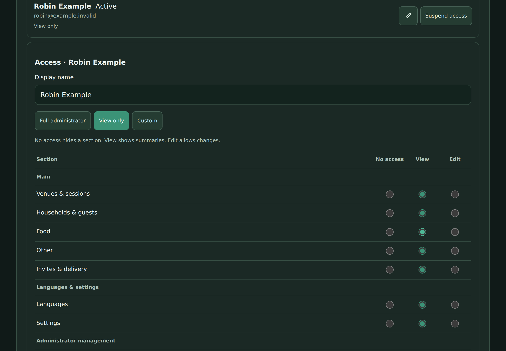
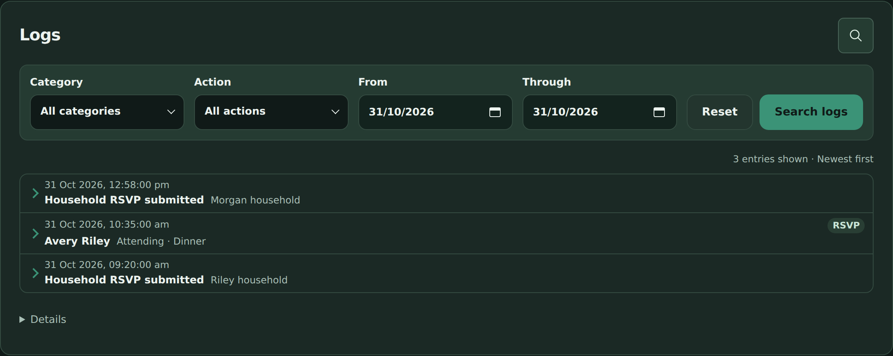

# Administrators

Use Settings → Administrators to review members, add someone, manage pending invitations and review sessions.

## Sign in and recover a password

The sign-in fields support password-manager AutoFill, including Apple Passwords. Use your administrator email and current password. The version number is at the right of the top menu.

Choose **Forgot password?**, enter your administrator email and select **Send reset link**. The result uses the same wording whether or not an account exists. Delivery depends on the installation's Supabase Auth email configuration.

Open the latest recovery email and choose a new password of at least 12 characters, then confirm it. Save changes only the Supabase Auth password; your RSVP Manager permissions are retained. After a successful reset, sign in again. Recovery applies only to the account identified by its reset link; a different account signed in elsewhere remains separate. Expired, consumed or incomplete links offer a new reset request. Network failures retain the draft for retry; refreshing a consumed recovery screen does not open the dashboard.

The recovery link returns to this installation's exact `admin/` address, including any hosting subdirectory. Use the installation's approved Auth redirect address. Native device AutoFill and actual email delivery still need operator acceptance.

## First administrator and setup closure

For a new installation, the trusted setup companion can create the first **Supabase Auth account** and grant it Full administrator access. Its Local mode requires the current empty schema, local Auth and Edge Functions to be installed first; Cloud mode performs the dedicated-project setup. See [first-time setup](AutomaticSetup.md).

The setup wizard link disappears once setup is locked. Opening `setup.html` directly cannot reopen first-admin creation after an administrator exists, the installation is completed or the event is published. A suspended administrator does not make the installation new again. Use sign-in or password recovery for an existing installation.

## Access levels

- **Full administrator:** all sections and access management. At least one active Full administrator must remain.
- **View only:** read the permitted information without ordinary editing, invitation sending or backup operations.
- **Custom:** choose No access, View or Edit for each section.

Invitation sending, managing administrator membership, revoking other administrators’ sessions, exporting backups and restoring backups are distinct powers. **Manage members** covers administrator membership management; only Full administrators change access permissions. A local pencil never overrides the account’s permissions.

Use the pencil beside a member to change their name or access. Save requires confirmation. Cancel discards the draft.

## Working with another administrator

When event data changes, a dialog offers **Refresh** and **Dismiss**. The app checks when you return to the tab and periodically while it is visible. The dialog waits while an editor is open. **Dismiss** acknowledges the current update. A later change can show a new dialog.

If a household, venue or session changes while you are editing it, the app stops the older save and leaves your edits open. Note your changes before closing the editor. Refresh, reopen the record and apply your edits to the latest version.

## Add someone

Enter a display name and email, then choose:

- **Send invitation:** the person receives an email and must verify/sign in and explicitly accept.
- **Add manually:** the app checks for an existing account with a verified email and asks you to confirm. It does not send an invitation email.

New additions start with View only access. Full administrators can customize a pending invitation with its pencil, or change the member’s access after addition.

## Suspend, enable or remove

Use **Suspend access** before choosing **Remove administrator**. Their account and historical records are retained. Enabling a suspended or restored member requires a verified account and confirmation.

Re-enabling does not revive old revoked sessions: the person signs in again. Administrators listed as Restored · Disabled need their access reviewed before you enable them.

## Sessions

Everyone can revoke their own application sessions, including their other sessions. A separate permission allows revoking other administrators’ sessions. If you cannot view Administrators, open the first **Interface** tab under **Settings → Interface** to find your sessions.

Use **Revoke session** to end that browser’s access on its next request. The session list shows the browser and device when recognizable. **Session refreshed** shows when the sign-in last renewed, if that time is available.

## Logs

Full administrators can open **Settings → Logs**. Search for a name or change, or select several categories and actions in their dropdowns. The **Guests** and **Admin** shortcuts in **Category** start with all recorded activity for that group. You can then narrow the results further.

Enter dates as **DD/MM/YYYY** or use the calendars in **From** and **Through**. Use **Search logs** to apply the dates and search text or **Reset** to clear the filters. Date filters use the event time zone, and the list shows your local time.

**Household RSVP submitted** records that the household submitted and locked its RSVP. Separate rows show each guest’s answer and the session it belongs to. Expand a row for more information, then open **Technical details** if you need its log reference, UTC timestamp or submission ID. Invitation opens from the same household within 15 minutes are grouped.

## Personal settings

Settings first opens **Application**. **Settings → Interface** opens **Interface**, **Invites appearance** and **Overview appearance** directly to their preference controls. The Interface tab contains **Appearance** and **Date and time**, plus HTTP/SSL and Apple Shortcuts. Each preference form saves its own choices to your administrator account. **Button hover appearance** offers Toolbar, Pencil and Create examples. Delete actions stay red, with an icon and label on desktop and a label on phones.

[All user guides](README.md)
