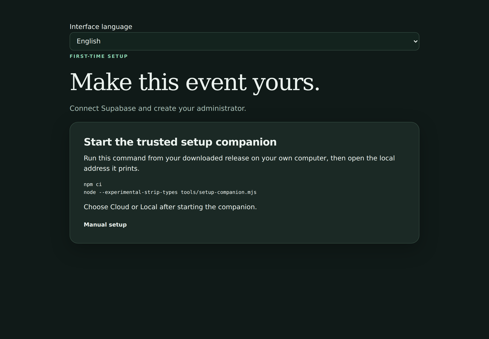

# First-time setup with the trusted companion

The trusted setup companion initializes a dedicated Supabase Cloud project and creates the first administrator. Its Local mode creates the first administrator on an already installed empty local Supabase schema. It runs temporarily on **your computer**. The public website stays static; do not put a Supabase secret/service_role key, database connection string or Management API access token into its configuration, Actions variables or browser storage.

For a local Docker Supabase stack, first complete the schema, Auth, secrets and Edge Function steps in the [Local guide](LocalSetup.html). You can then choose Local Supabase in the companion to create its first Auth account and application administrator. SQL Editor/Studio installation remains available through the [manual setup](../setup.html) and [Studio guide](StudioSetup.html). The cloud Management API does not manage a local Docker stack.

## Start the companion

Download/extract the selected RSVP Manager release on a trusted computer with Node 22.23 or newer. From its root:

```sh
npm ci
node --experimental-strip-types tools/setup-companion.mjs
```

Open the printed **http://127.0.0.1:8090/** address on that computer. If the port is in use:

```sh
node --experimental-strip-types tools/setup-companion.mjs --port 8091
```

The listener is deliberately bound to loopback. Do not expose or proxy it publicly. If running it on your own remote VM, forward the local port over SSH and open the forwarded 127.0.0.1 address on your computer:

```sh
ssh -L 8090:127.0.0.1:8090 USER@VM_HOST
```

The automatic page on a static website displays these startup instructions; it does not accept privileged credentials there. All automatic-wizard requests go to the local companion. Its scripts/styles are local, with no third-party browser scripts in the credential-entry page.



## Local first administrator

Choose **Local Supabase** in the companion. Provide its loopback API address, public browser key, privileged Auth key, local PostgreSQL connection and final website base URL. API and database connections must point to the same installation; remote database/API addresses are refused in this mode. Privileged values stay in the local process and are cleared from the form after connecting.

Use **Verify database**, enter and confirm the administrator email/password, then create the account. The companion creates a real Supabase Auth user, verifies password sign-in and grants protected Full administrator access. A matching existing verified Auth account requires its current password; an email address alone never claims it. Once the administrator step succeeds it cannot create another first administrator.

Use the API and PostgreSQL addresses from the same local installation. Before granting access, the companion checks that the Auth account is visible with the same ID in that database. If identity verification fails, review both connections before retrying; the application administrator grant is refused.

Finish verification after the local Edge Functions are deployed. It checks the current schema, the confirmed Full administrator and protected function responses while keeping the event unpublished. Completion closes setup and offers public configuration and sign-in. Local mode does not install/replay the database, deploy Docker services, change Auth redirects or act as an upgrade/reset tool.

## Cloud setup steps

1. **Connection.** Provide the canonical `https://PROJECT_REF.supabase.co` URL, its matching 20-letter reference, a publishable/legacy anon key, a secret/service_role key, a Supabase Management API PAT and the **final website base URL**, including any subdirectory/trailing slash. Use a dedicated healthy project with Data API enabled. The service validates project/public/Auth Admin access and reads the required management endpoints. Missing write permissions are reported at the relevant step; validation does not pretend to prove writes by making unrelated changes.
2. **Database.** Install the hash-checked complete installer atomically, or add missing tables/functions/views/triggers/policies/indexes/constraints/identity definitions to a compatible partial installation. Existing rows and function definitions are not replaced. Column/type or function-body incompatibilities, unrelated public tables, a published event or conflicting administrator state stop initialization. A failed SQL transaction rolls back. Retry uses the current schema rather than creating duplicate objects.
3. **Administrator.** Enter email and password, then confirm the password. The server uses `auth.admin.createUser({ email, password, email_confirm: true })`; the account appears in **Authentication → Users**. Authorization is in protected `public.admins`, with the existing full permission preset and session/RLS checks—not editable user metadata. An existing Auth account is reused with its current password, without a password reset. Unconfirmed bootstrap accounts may be confirmed by the trusted service. The service verifies actual password sign-in and `is_admin()` before continuing. A lost creation response is recoverable without duplicating the account. A completed administrator step stays closed while the remaining setup steps can resume. Passwords never enter application settings or logs.
4. **Secrets.** Configure `RSVP_SITE_ORIGIN` and `RSVP_SITE_URL`. Platform `SUPABASE_URL`, `SUPABASE_SERVICE_ROLE_KEY`/`SUPABASE_SECRET_KEYS` are provided by Supabase; the companion does not overwrite reserved platform secrets. Current functions require no third-party API secret. Optional application secrets use unique `RSVP_` names (maximum ten, 8KB each, subject to the 64KB request limit). Unrelated secrets are preserved. Values are not displayed after submission; provider metadata/digests verify configuration.
5. **Functions.** Deploy only `guest-gateway` and `admin-invitations`, using this release's integrity-checked, self-contained Studio bundles. Both require `verify_jwt=false` because their existing handlers perform application validation. Existing compatible JWT settings and display names are retained. A conflicting JWT setting stops the step for operator review instead of being silently changed. Other functions are untouched. Deployment is followed by metadata/status checks.
6. **Configuration.** Set Auth Site URL and merge the administrator invitation redirect and exact `admin/` recovery address into the existing allowlist. Ensure `public` is exposed to the Data API and `app_private` is not, preserving unrelated settings. Existing event defaults come from the installer; only an unset website URL is filled. Setup does not publish the event.
7. **Verification.** Recheck schema, confirmed full administrator, secrets, function metadata, protected runtime responses, Auth redirects and Data API schemas. Require the event to remain unpublished. Only then write the initialized state, discard temporary privileged credentials and offer administrator login/public configuration.

The privileged database mechanism is the Management API SQL endpoint, not a browser query or an Edge Function that would itself need installing first. Scope the PAT to the selected test project. It needs Database, Project Settings, Auth Config, Data API Config, Edge Functions and Edge Function Secrets with read/write access, plus Data API JWT Secret read access for the PostgREST configuration read. Auth configuration updates require both Auth Config and Project Settings write access. See the [current permission reference](https://supabase.com/docs/guides/platform/personal-access-tokens#permission-scopes). Connection proves the required reads; setup steps prove their writes, and a 403 remains a permission failure rather than a successful check.

## Publish only public browser configuration

After completion, download **config.js**, containing only the project URL and public browser key. For direct static hosting, install it as `js/config.js`. For the existing GitHub Pages deployment workflow, set `RSVP_SUPABASE_URL` and `RSVP_PUBLISHABLE_KEY` as Actions variables and redeploy. The setup companion has no GitHub credential and does not edit an unrelated hosting repository for you.

**Continue to administrator login** transfers only public connection values in a URL fragment to the chosen website's existing setup page. That page clears the fragment, configures this browser and opens administrator login. This lets the installer sign in immediately, but other devices still need the published public configuration. An unconfigured browser can accept that public handoff. On an already configured installation, the transferred project URL and public key must match its current configuration; a different target is refused without replacing the configuration. A handoff cannot bypass a locked or unverifiable setup checkpoint. Configured applications use the minimal `get_setup_status()` probe to close first-time setup after an administrator exists, an installation completion is recorded or the event is published. Direct `setup.html` access and a `manual` query parameter cannot reopen it. Public configuration can still be handed off to sign-in without running setup again.

No secret/service_role key, PAT or administrator password belongs in `config.js`. Do not put them into a public Actions variable or source file.

## Interrupted setup and errors

- Project progress is stored in protected `app_private.installation_state`: release/installer identity, completed steps, site URL, first administrator ID and secret digests. It contains **no credential values or passwords**. Pending administrator email is cleared on successful completion. This operational table is intentionally outside the 40-table application backup manifest; it is not an event/guest record or an Auth backup.
- Reloading the companion page reuses its temporary session. After process restart, disconnect or the 30-minute idle timeout, reconnect with credentials and the same website URL/release build; completed project steps are rediscovered. A different installer hash or website URL cannot silently take over a partial setup.
- A failed database, Auth, secret, configuration or deployment step retains completed steps and gives a retry. Re-enter a cleared password/optional secret when retrying it. The UI does not retain sensitive inputs for convenience.
- An already initialized application is detected and left unchanged. The completion page says it is an existing installation; it does not claim the event is unpublished or change its settings. This first-time wizard is not a general upgrade/recovery tool.
- The service only adds absent objects in compatible partial schemas. It refuses incompatible existing definitions rather than guessing destructive repairs. No reset command runs automatically.
- If Data API is disabled, enable it in the project's API settings before administrator RPC verification. If a function has not propagated yet, retry its verification. A 401/403 requires checking keys or PAT permissions; provider error bodies/SQL/secret values are not echoed.
- Use **Disconnect and forget credentials**, then stop the process with Ctrl-C. Privileged credentials exist only in temporary process memory while needed; there is no claim of cryptographic RAM erasure. Same-origin/CSRF checks, a strict Host check and a loopback listener protect the local HTTP interface.

## Verification and scope

Repository acceptance uses the actual Supabase JS Auth Admin client, disposable PostgreSQL-compatible SQL and synthetic Management/Auth/runtime HTTP responses. Tests cover fresh/partial/already-installed schemas, bad keys/permissions, atomic failures, lost Auth responses, retry, administrator login/authorization, secret/function failures, configuration preservation, HTTP security, no credential storage/echo and phone/desktop EN/DE/FO UI. These checks do not replace a fresh operator-owned Supabase Cloud acceptance run. No real project is created, reset or reconfigured by tests.

Developer commands:

```sh
node --experimental-strip-types tests/automatic-setup.mjs
node --experimental-strip-types tests/automatic-setup-http.mjs
node --experimental-strip-types tests/local-administrator-setup.mjs
node --experimental-strip-types tests/automatic-setup-live-acceptance.mjs
node --experimental-strip-types tests/automatic-setup-browser.mjs
```

TypeScript is checked with the pinned compiler; runtime uses Node's native type stripping. Existing builds keep installer/Studio/CSS/locale outputs synchronized. Full release/hosted CI includes the new acceptance; ordinary development still uses targeted checks.

## Opt-in live Cloud acceptance

Automatic Cloud setup remains experimental until it passes on a dedicated empty project owned by the operator. Disposable tests and a passing local preview do not satisfy that acceptance. Never choose an existing event project for this run.

The optional acceptance runner uses the same trusted setup implementation. Supply an owner-only JSON file through standard input on the trusted computer, with `credentials` containing `projectUrl`, `projectRef`, `publicKey`, `serviceKey`, `accessToken` and `siteUrl`, plus `administrator` containing `email` and `password`. Keep that file outside the repository and public webroot; do not put credentials in chat or command-line arguments.

```sh
node --experimental-strip-types tools/accept-automatic-setup.mjs --accept-empty-project PROJECT_REF < /private/path/setup-acceptance.json > /private/path/setup-result.json
```

The explicit reference must match the supplied project. The runner refuses application tables, Auth users, storage contents/buckets or Edge Functions before changing anything. Standard Supabase system schemas are retained. It then verifies the real deployments, bounded propagation retries, first administrator sign-in, public-only configuration, minimal setup status and initialized reopening without another write. Progress and the final result exclude passwords, privileged keys and administrator email. The deadline is 15 minutes, with at most five attempts for transient steps; permission errors stop without retrying.

This runner starts only from an empty target. If setup fails after creating progress, resume that project through the companion instead of resetting it or rerunning a fresh installer. The runner never creates, deletes or resets a project, and it leaves the test event unpublished. A live run and its protected evidence are still required before promoting automatic setup.

## Supabase references

- [Auth Admin createUser](https://supabase.com/docs/reference/javascript/auth-admin-createuser)
- [Management API SQL query](https://supabase.com/docs/reference/api/v1-run-a-query)
- [Management API function deployment](https://supabase.com/docs/reference/api/v1-deploy-a-function)
- [Auth service configuration](https://supabase.com/docs/reference/api/v1-update-auth-service-config)
- [Official Management API OpenAPI contract](https://github.com/supabase/supabase/blob/master/apps/docs/spec/api_v1_openapi.json)

The implementation checked these current endpoints and their multipart/parameter formats on 14 November 2026; the scoped-token permission reference was checked again on 16 November 2026. It uses Management API HTTP calls and the pinned SDK; it does not depend on a functioning Supabase CLI deployment command.

[All user guides](README.md)
