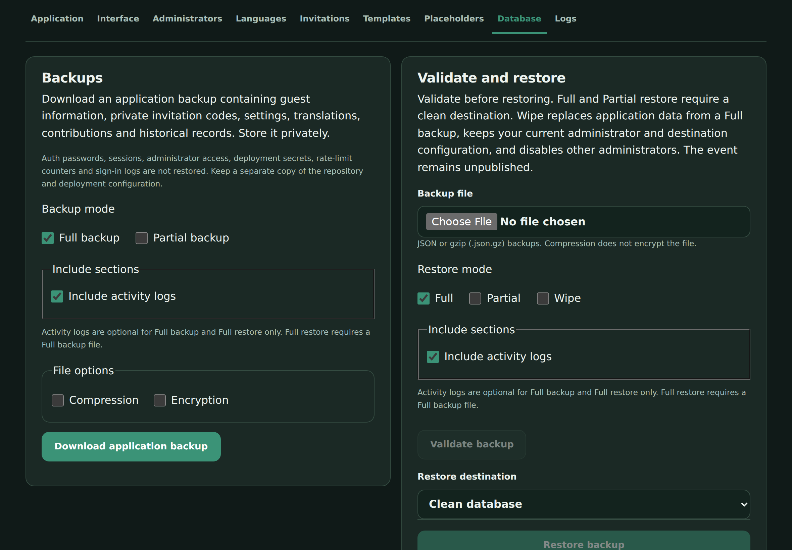

# Backups

Application backups are private downloads and may contain names, contacts, invitation codes, replies, commitments and the invitation background photo.

Under **Settings → Database**, Backups and Validate and restore appear side by side on wide screens and stack on narrower screens. Resizing preserves your selected modes, sections and file options. Validation and confirmation are still required before restoring.

## Full and Partial modes

Open **Settings → Database** and choose one mode using the checkmarks.

| Operation | Activity logs |
|---|---|
| Full backup | Optional |
| Partial backup | Excluded |
| Full restore | Optional, only if present in the Full backup file |
| Partial restore | Excluded |

**Full backup** keeps all sections, current replies, immutable RSVP submissions/comments, food commitments, confirmation state and manually confirmed Sent invitations. **Full restore accepts Full backup files only.** It restores everything available in that file. A file exported without logs cannot supply them later.

**Partial backup/restore** retains the existing planning-template behavior: select planning sections and reset current invitation codes, replies, food commitments and delivery state. Food starts at Collect interest. Logs are always excluded; the checkbox is cleared and disabled in both Partial modes. A Partial backup file cannot be used for Full restore.

Partial mode shows **Venues & sessions**, **Households & guests**, **Food**, **Other**, and **Wording & invitation templates**. Event settings and languages are always included, including the configured private photo/appearance. Full mode hides section choices and includes every available section regardless of hidden Partial selections.

A food planning section without venues leaves venue-specific items unavailable until assigned again. Category/sub-category structure and Food Group membership are retained. Partial backups do not retain administrator-added food commitments.

## What the log option covers

In Full mode, **Include sections → Include activity logs** controls restoration of existing administration, configuration, access, delivery-change and RSVP-change logs, old restore history and administrator invitation/reference history. Logs can contain personal details. Current replies/submissions, food commitments and Sent records remain in Full mode even when logs are excluded.

Without logs means old activity history is omitted. Every completed restore still records a **new restore audit entry**; this safeguard is always enabled. No imported snapshot-history feature is used.

## Compressed files

Tick **Compression** under File options to download a smaller gzip file in either Full or Partial mode. Leave it unticked for JSON. Restore accepts either file and opens gzip automatically; the backup contents, checksum and validation rules are unchanged. Both the uploaded file and its opened contents must be at most 20 MB. Damaged or oversized compressed files are rejected before validation or restore.

Compression alone does not encrypt the file. Select **Encryption** separately to protect it with a password. If your browser does not support gzip, the compression option is disabled; use JSON instead.

## Optional encryption

Select **Encryption**, enter a password and confirm it. Compression and encryption are independent; gzip is applied first. Encrypted files download as `.encrypted.json`. Keep the password separately: the file cannot be recovered without it.

Encrypted imports are detected automatically and request that file’s password. Incorrect passwords or damaged files stop before database validation; use Open encrypted backup to retry. Unencrypted JSON/gzip continues unchanged. Decryption does not bypass Validate backup or restore confirmation.

Encryption requires HTTPS or localhost, Web Crypto and Web Workers. See [encrypted backup details and development testing](BackupEncryption.md). Passwords are not saved in settings or browser storage and are not sent to the server for encryption.

## Clean-database recovery restore

Choose **Clean database** for the original recovery workflow. It requires an **empty, unpublished destination**.

1. Prepare the destination with the current alpha baseline and a verified administrator.
2. Choose the file. Its available sections and log flag determine the choices. Full restore is unavailable for Partial files.
3. Choose a mode, sections where applicable, and the Full-mode log option. Changing any choice invalidates prior validation/confirmation.
4. Validate. The server rehearses the restore and rolls it back. Full restore may require matching verified historical actor accounts wherever retained records reference them. Resolve reported problems before proceeding.
5. Review the result and select **Restore backup**. Choose **Yes** to proceed or **No** to return to the review.
6. The application returns to **Main → Invites** after a successful restore. Check representative households, replies/comments, food, translations, assignments and any included logs.

The restored event stays **unpublished**. Review administrator access separately: included historical administrator references return disabled with View only permissions; source access rights are not automatically granted.

Store protected copies away from the planning device and agree retention and recovery ownership.

## Replace event data on this installation

Use this separate destination to return an existing unpublished event to an earlier backup before a test. It requires a full administrator and a complete current-schema Full backup downloaded from the same installation. Partial files and other installations are rejected.

1. Install matching code/schema, then take a fresh Full backup before testing. Protect it and its encryption password.
2. Select **Replace event data**, open that backup and validate. Review current versus restored record counts and the preserved security boundary.
3. Download the fresh safety backup offered by the page. It captures the state being replaced and uses your selected compression/encryption options.
4. Select **Replace event data** and choose **Yes** to proceed or **No** to return to the review. If data changes or the 30-minute confirmation expires, validate again and download a new safety backup.
5. After replacement, **Main → Invites** opens. Review representative invitations, replies, food, wording and pictures. The event remains unpublished.

Event settings, private pictures, household invitation codes, replies, food commitments and delivery records return to the backup state. Current Auth accounts/passwords, administrator access/sessions, pending administrator invitations and security/restore audit history remain; a new restore audit is appended. Failed validation or replacement rolls back atomically. This cannot undo messages already sent or changes to Auth, hosting or runtime configuration.

## Current alpha format and infrastructure recovery

Current exports use application backup **format 2**, schema **20261114034908**, with 43 application tables. Column manifests use a stable field-name order, independent of physical database column order. This alpha accepts the current schema only; download a fresh backup when testing a changed schema. There is no old-backup compatibility adapter. Language CSV exports are separate.

Passwords, Auth sessions, personal administrator Interface preferences, secret keys, email-service settings, rate-limit counters and hosting configuration require separate infrastructure recovery. App sign-in references, if included, are historical information rather than active sessions. Raw Auth-service audit records are not application-backup data. Keep the repository/deployment configuration with the installation owner and rehearse restoration.

[All user guides](README.md)

## Wipe and restore application data

Choose **Restore mode → Wipe** to import a complete Full backup into an existing unpublished installation, including one exported by another installation. Both installations must have the same current schema and exact backup fields; older alpha files are not adapted. The file may include or omit logs. Wipe uses the whole file and its log selection; Full and Partial clean recovery remain separate.

1. Open the Full backup and select **Download safety backup**. This validates the file and downloads a fresh safety backup if validation passes. Store it privately.
2. Review the record counts, then select **Wipe and restore**. Choose **Yes** to proceed or **No** to return to the review. If data or administrator access changes, or the 30-minute receipt expires, select **Download safety backup** again.
3. Review the imported event from **Main → Invites**. It stays unpublished.

Wipe replaces application data and cancels imported pending administrator invitations. It keeps the signed-in administrator's access, Auth account and personal preferences, destination website address and runtime/connection configuration. Other administrator accounts are suspended and their application sessions revoked; their Auth accounts/passwords are not deleted. Historical actors are matched by verified email. If no verified destination account matches, the importing administrator is used for the foreign key; original identities and per-record attribution are retained in the new restore audit. The destination installation ID remains unchanged.

Wipe cannot undo messages sent from another app. A database/Auth/runtime backup remains the way to recover infrastructure and account state; an application safety backup does not replace it.

## Wipe all without importing a backup

**Settings → Database → Wipe all** clears application data. It requires a Full administrator and an unpublished event. It is separate from the Wipe restore mode above, which imports a Full backup.

1. Review the current counts and choose whether to retain your current administrator.
2. Download the required fresh safety backup. The download uses the selected backup compression and encryption options. Keep the file and any password privately.
3. Select **Wipe all**, then choose **Yes** to proceed or **No** to return to the review. A changed destination, expired preparation or uncertain response requires a new review; the page does not retry automatically.

This clears event content, private pictures, household links, replies, food commitments, delivery history and application administrator access. With **Retain current administrator** checked, only your current application administrator remains and **Main → Invites** opens. With it unchecked, the application signs you out and opens the first-administrator setup wizard. Supabase Auth accounts and passwords are retained in either case. Connection configuration, the database schema and installation identity remain. Retired invitation codes and session revocations remain protected against reuse.

The empty event is unpublished. All Shortcuts capabilities are revoked and the experimental feature is disabled. An application safety backup does not restore Auth passwords or infrastructure configuration; follow the installation owner's recovery procedure.
