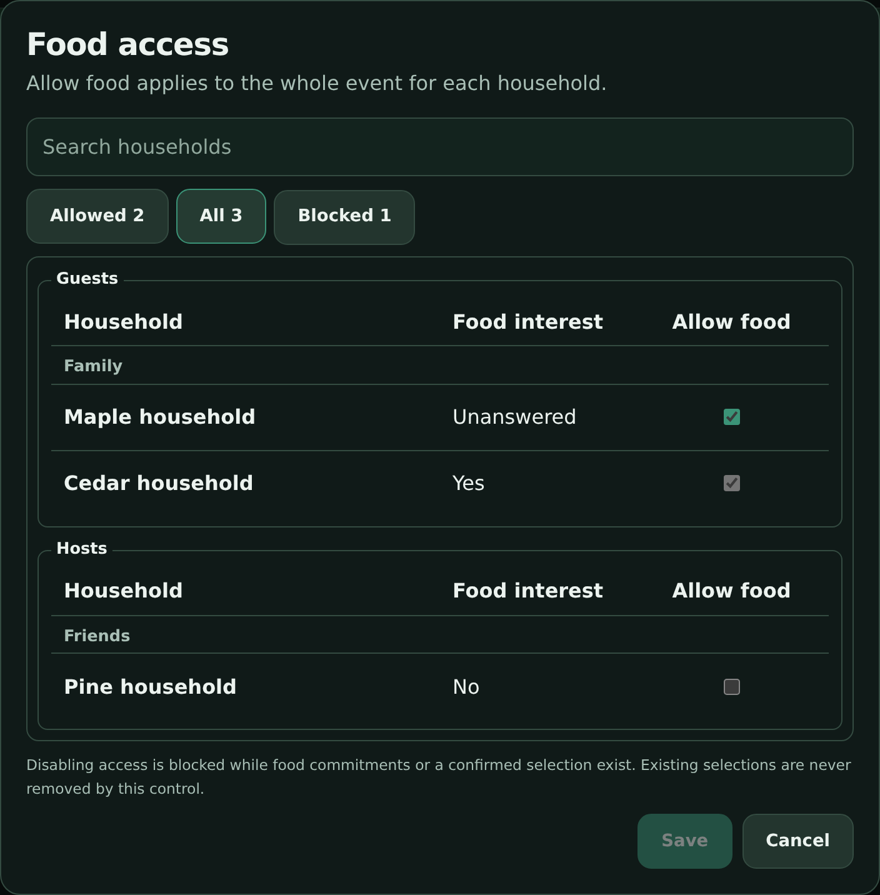
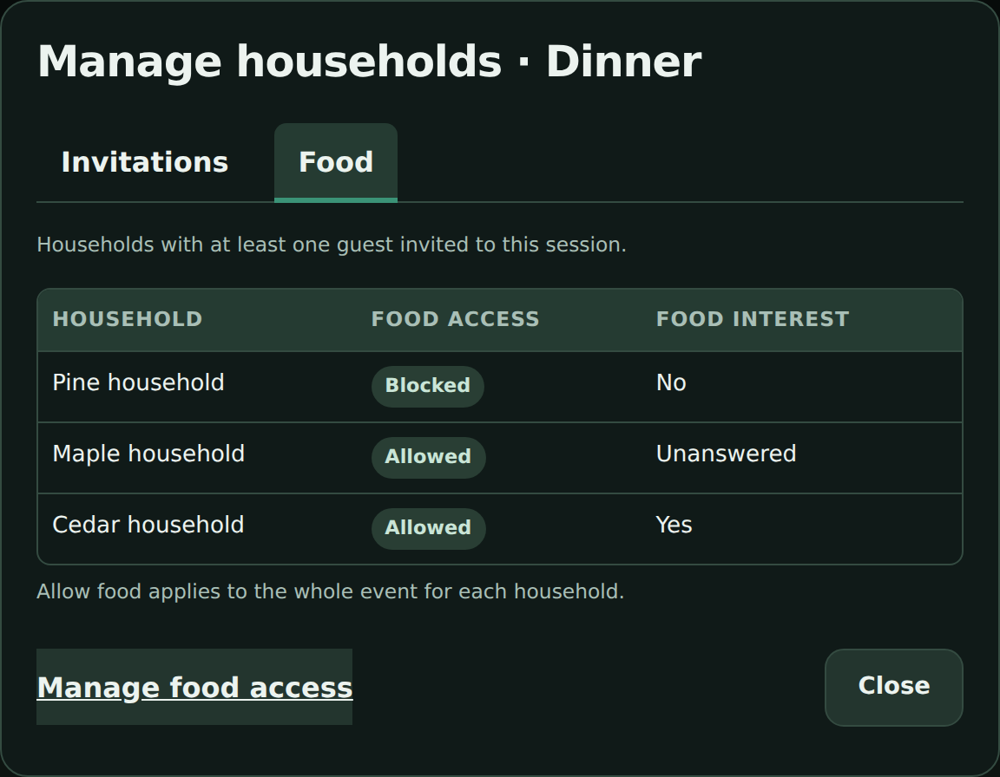
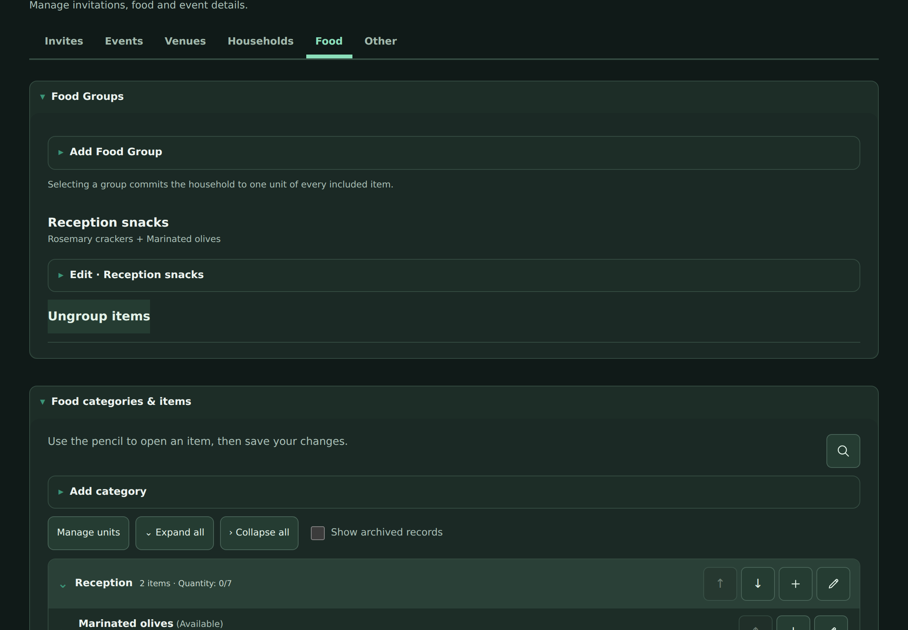
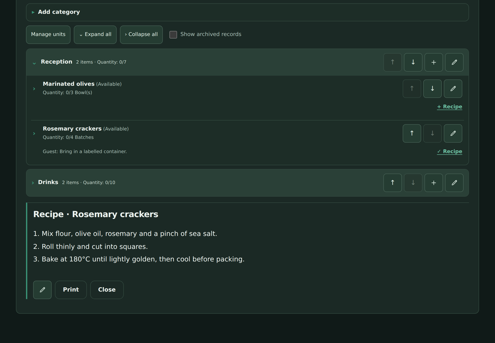

# Food and recipes

## Choose when guests see food choices

Under **Home → Events → Features**, enable Food and start with **Collect interest**. Guests save their Yes or No with **Submit responses** when they also owe an RSVP, or **Confirm food answer** when only the food question is due.

When the menu is ready, open **Home → Food**, select **Open food choices** and confirm. The status changes to **Choose food**. Send eligible households their original invitation link again when appropriate. A household with a saved RSVP and Yes sees who is attending and the available food choices on the same page. Confirmed items appear under **You’re bringing** on later visits.

## Check which households have food access

Open **Food access** in **Home → Food** to see who is allowed to choose food. Households follow the saved group order from **Home → Households**. The list starts on **Allowed**. Use **All**, **Blocked** or the household search to find other entries. **Food interest** shows the household’s saved Yes, No or Unanswered response. The dialog requires Food and Households view access. Administrators with Household Edit permission can change **Allow food** and save. Households with existing commitments keep their access. The same setting is available in **Home → Households → Household details**.

In **Home → Venues → Sessions → Manage households**, **Invitations** controls who is invited to the session. The **Food** tab shows food access and saved interest for households with an invited guest. **Manage food access** opens the event-wide list for edits.

Edit the guest explanation at **Languages globe → Guests → Food explanation**. Configure the response after a saved Yes at **Guests → Food Interest Reply**, including an optional RSVP-deadline date placeholder and missing-deadline fallback. See [Languages](Languages.md#guests-food-text). The detailed list stays hidden throughout Collect interest.

In **Invites**, click **Yes**, **No** or **Unanswered** under Food interest in the **Food items** statistics box to filter the household list. Click the active choice again to clear it, or choose **All** in the Invites statistics box to clear both invitation-status and Food-interest filters. These counts are available during both food steps when Food is enabled. Each household’s row shows its saved answer. The Food items summary repeats the totals separately from item availability and contributing households. Counts include active households with at least one active guest; empty grouping households and archived records are excluded. Food access does not change the saved interest answer. Food View permission is required to see this reporting; answers are not inferred from attendance, Sent state or item commitments.

Changing the step does not publish the event or send invitations. Returning to interest hides the list while preserving commitments. Disabling Food hides its section and blocks guest food responses/reservations without deleting records. Other has its own enable switch.

Food explanations and replies are event-specific text, separate from shared interface wording.

## Categories, items and groups

**Food Groups** and **Food categories** have separate expandable boxes, each with its own Add section. Category headers show their own nonzero item count and picked/needed quantity. The direct sub-category count appears only when there is at least one; zero sub-categories are omitted. Arrows change saved sibling order; the pencil opens Name and Parent category side by side when space permits, with a matching translation globe beside Name and Save/Cancel below. Empty categories have a guarded Delete action at the editor’s lower right, opposite Save/Cancel. The category’s **+** opens a popup with **Add item** and **Add sub-category**; there is no separate sub-category button.

An item has a name, amount needed, unit, category, guest/admin notes and venue availability. Its pencil opens the editor. The globe beside Name opens translations; the pencil beside Unit manages units. Admin note sits under Unit and Guest note under Category. **Show to guests** is beside Cancel. Save applies changes; Cancel discards them. Translation dialogs preserve unfinished item/category drafts.

Admin notes are private to administrators with Food access. Guest notes appear in eligible guest views. Change category through the editor’s dropdown. Unit translations are shared rather than repeated for each item.

Category summaries omit zero item counts and zero-over-zero quantities independently. Nonzero capacity or commitments remain visible. Availability appears beside the item name; picked/needed quantity and unit appear underneath unless both quantities are zero. Hidden, Fully assigned and Available describe selection status. Increasing capacity above the picked quantity makes an otherwise eligible item available again. Items with commitments must remain visible until those assignments are removed. Expand all opens categories; Collapse all also closes nested items.

Delete removes an unused item after confirmation. Items linked to commitments, commitment history or Food Groups must be archived instead. Archiving preserves existing commitments and prevents new selections; Restore makes the item eligible again subject to its normal visibility, venue and capacity rules. Show archived records sits beside Expand all / Collapse all. Category deletion is blocked while any item (including archived items) or Food Group still belongs to it.

## Food Groups

Use **Add Food Group** to combine at least two existing items, such as chips and nuts. Enter the name in the selected interface language, choose a category and members, and save. Other-language names are preserved.

Guests select one box that reserves one unit of **every member** atomically. Each item retains its own capacity, notes and recipe. An item belongs to at most one group. Resolve commitments before changing membership or using **Ungroup items**; ungrouping retains the individual items.

## Commitments and venue eligibility

Names and quantities under an item are actual household commitments. Use **Add household**, the assignment pencil or **Remove assignment** to manage them. The same commitment appears in that household’s Food area; enter it only once.

Choose venues in the item editor. For bulk changes, use **Manage food** on a venue to open the assignment dialog and save your selected items. Other venue assignments are retained. Guests also need the appropriate session invitation and household food access.

## Guest flow

Guests confirm food interest alone or submit it with an outstanding RSVP. A saved Yes records interest without reserving an item. When choices open, eligible guests return through their original invitation link, see **Your RSVP**, and choose items or groups. **Back to edit** retains reservations, and confirmation locks them. Later visits show confirmed items and quantities under **You’re bringing**. An existing commitment stays in place if a guest needs help changing an answer.

## Recipes and translations

**Recipe ✓** means a recipe exists. **+ Recipe** starts a new recipe when none exists. Existing recipes open read-only with Print/Close and a pencil if you can edit. There is no separate Language text link beside an item: use its editor globe or the Languages page.

Read-only administrator and guest recipes share a dialog with **Print** and **Close**. Print opens your device’s print/PDF options. Closing returns focus to the link without moving the page. View-only accounts cannot edit recipes.

After opening the recipe’s pencil, its editor provides **Save**, **Cancel** and **Preview**. Preview prints the draft; Save is still needed to retain changes. Viewing/printing never changes commitments.

[All user guides](README.md)

## Sub-categories and guest quantities

Add category presents Name first and Parent category second. Choose its parent there, or select **Add sub-category** from a category’s **+** popup to prefill the parent. Its pencil lets you rename or move it. Category dropdowns show complete paths; stored item assignments and existing commitments are retained. Arrows reorder siblings. Move children and items away before deleting a category. Cycles and more than eight levels are rejected, including in restored backups. Category names remain unique throughout the event.

Guests see the nested categories, guest note, total needed quantity and remaining availability. They choose a quantity before selecting an individual item; changing a selected quantity updates its reservation. Concurrent capacity checks still apply. Existing Food Groups reserve one unit of every included item.
