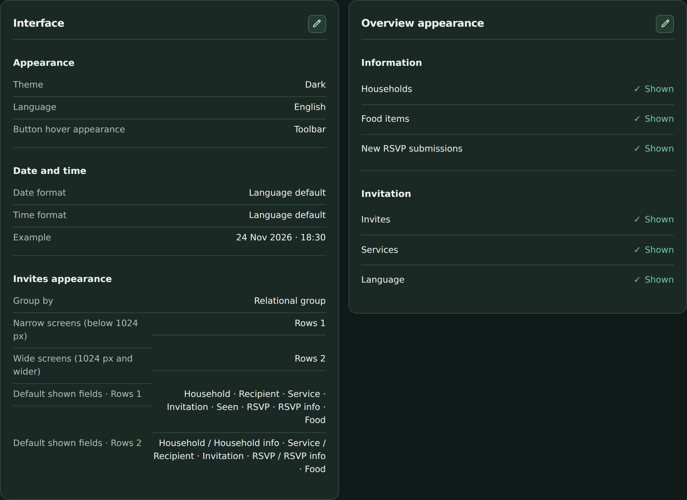
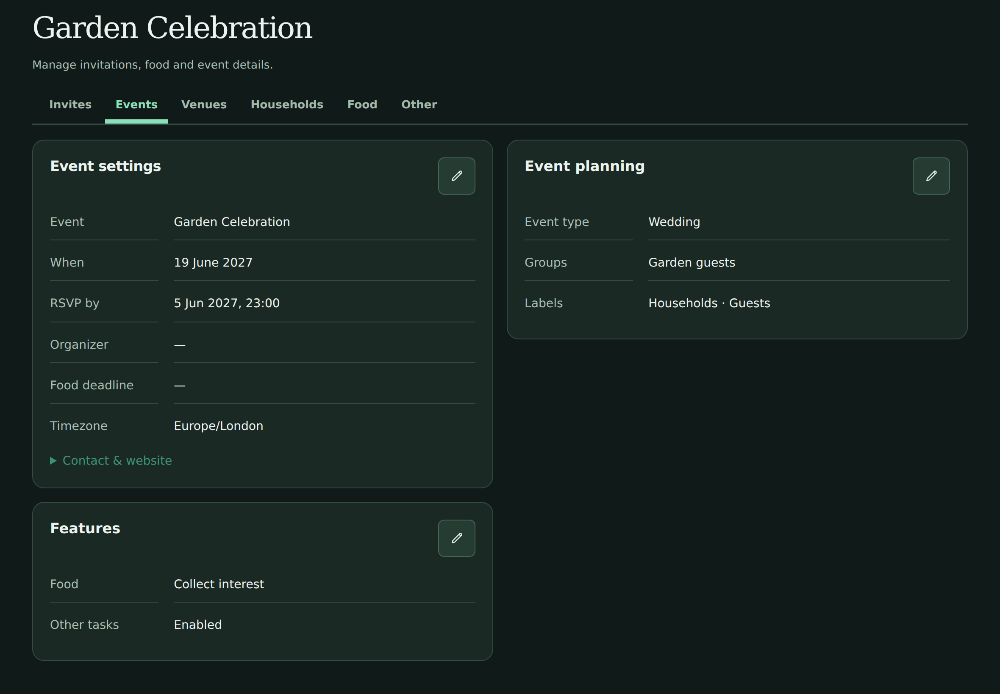

# Getting started

Open the administrator link for your installation and sign in with your own account. If you have received an administrator invitation, verify your email and accept it first.

Sign-in supports password-manager AutoFill. If you have forgotten your password, choose **Forgot password?** and follow the latest reset email. The new password must have at least 12 characters; resetting it keeps your administrator permissions. See [administrator sign-in and recovery](Administrators.md#sign-in-and-recover-a-password).

For a first installation, use the [trusted setup companion](AutomaticSetup.md) to create the first Supabase Auth account and grant Full administrator access. Setup closes at the installation checkpoints and its link is hidden afterward. Opening the setup address again does not create another first administrator or reset the installation.

## Find your way around

The three icons at the top open **Home**, **Languages** and **Settings**. On desktop, the release version appears under your name after sign-in.

Home opens **Main**, which contains Overview and Invites. The other tabs are **Events**, **Venues**, **Households**, **Food** and **Other**. Click Overview counts to filter Invites. Select households to see the draft, invitation and sending actions beside **View** and **Search**. When Apple Shortcuts is enabled, its box appears between Overview and Invites. [Manage invitation drafts](HouseholdsAndInvites.md#make-and-send-bulk-invites)

Your access determines which sections you see. The first Settings tab, **Application**, holds publication controls. Full administrators also see its launch checklist, with pending checks first and completed checks collapsed. The Publication card shows current access and delivery state. Acknowledge the release checks and confirm explicitly before publishing.

- Each record or settings box has its own pencil where you have permission.
- Use a record’s pencil to open its editor. Save keeps your changes; Cancel discards the draft.
- An unchanged existing record normally has a disabled Save button. A new, prefilled reminder is already a draft you can save.

Use the **Search** icon in Households, Invites, Food or Logs to open that list's search field. Closing it clears the search.

Editing one box does not open the others. Save closes that box after a successful update; Cancel discards its draft. Failed saves keep it open for retry. Someone with View only access cannot edit event records; personal Interface preferences remain available.

The top actions refresh the data, change appearance, open the sign-in-protected guest preview in another tab and sign out. **Settings → Interface** shows your saved **Appearance**, **Date and time**, and **Invites appearance** choices. Use its pencil to edit all three sections, then choose **Save** to apply them to your administrator account or **Cancel** to discard the draft. Saved choices load when you sign in on another device. The top-bar appearance toggle applies immediately.

- **Appearance** contains the theme, interface language and button hover settings.
- **Date and time** offers the language default, a short month name, a numeric date with dots, or year-month-day. Time can follow the language default or use a 12-hour or 24-hour clock. Pick a sample date to preview the format as you edit. The date picker itself follows your browser.
- **Invites appearance** holds grouping, row counts for narrow and wide screens, and default fields for each row layout. Household, Service and Invitation remain visible. Use the **View** menu in Invites for adjustments to the current view.

The neighboring **Overview appearance** panel has its own pencil. **Information** and **Invitation** show the saved card order and which cards are shown. Use the checkboxes to show or hide cards and the arrows to reorder within each group. **Reset to defaults** prepares a draft. Choose **Save** to apply it or **Cancel** to keep your saved layout.

When another administrator changes event data, **Event data has changed** appears after open edits are resolved. Choose **Refresh** to load the latest data. If a household, venue or session changes while you are editing it, a stale save is rejected and your draft stays in the editor.

## Prepare the event

1. Review event details under Home → Events.
2. Add venues, then sessions with the right venue and local time.
3. Add households and guests, preserving any parent–child grouping you need.
4. Assign session invitations in Households → Household details, or through a session’s household manager.
5. Add food categories and items, quantities, units and venue availability.
6. Review guest-facing text and translations.
7. Test a complete guest journey and keep a protected backup.
8. Under Settings → Application, publish only after you have reviewed and approved the event.

Adding a household does not automatically invite it to every session. Making a food item available at a venue does not send an invitation.

On a wide screen, Events cards and the Venues and Sessions & scheduling boxes share columns. Opening an event, venue or session editor expands its box across the row; closing it restores the compact reading layout. Narrower screens stack the boxes. Resizing keeps your unsaved draft.

## Set groups and event wording

In **Home → Events → Event planning**, review the current preset, shared labels and groups. Use the pencil in the card’s top-right corner to choose a Wedding, Reunion, Conference, or Custom preset. **Use preset suggestions** adds suggested groups and fills blank labels. Review and save the changes. You can also add, rename, translate, and reorder groups directly.

Shared labels appear in the main navigation, section headings, and the Invites statistics. Group names appear in Households, Invites, and session assignment lists. Move households out of a group before removing it. Planning-template backups carry the saved settings into a fresh installation.

## If you cannot see a section

Ask a Full administrator to review your access. Some actions, such as sending invitations, exporting backups or restoring an event, have separate permissions.

## Feature and guest appearance settings

**Home → Events → Features** enables Food and Other without deleting their existing data. Guest food step chooses interest-only or detailed selection; changing it does not publish or send anything. Edit the food explanation and the reply after Yes under Languages globe → Guests.

**Settings → Interface** holds your personal preferences. Event-wide customization is under **Settings → Invitations → Landing page → Invitation appearance** with independent Wide/Phone settings. Choose a mode to see its compact photo, colours, title, name and appearance summary; its pencil opens the existing editor. Replace/remove a private JPEG, crop and position it, adjust darkening and box opacity, and choose colors separately for Light/Dark. Open the single Preview to inspect the selected mode, including its unsaved changes. Save applies that mode, Cancel discards its draft, and Reset appearance restores the default treatment while keeping the photo. Photo dimensions, stored size and crop are available under Details. Choose whether guests see a light/dark toggle and their default Light, Dark or System appearance. Hiding the toggle enforces that default. System follows the device; guest choices are separate from administrator choices.

Venue summaries include mini maps; edit the venue’s saved map URL in its editor. Guest sessions place the welcome beneath the session name, followed by address/time and map. Use authenticated Guest preview to check presentation while unpublished.

[All user guides](README.md)

## Temporary status messages

In **Settings → Invitations**, **Status messages** has the same visible heading, Wide/Phone selector and top-right pencil as Invitation appearance. Select a mode, then use its pencil to change Admin and Guest. Each mode has an independent read view, draft and Save/Cancel. Choose the message filter, **Hide messages after 5 seconds** and **Show timestamps**, then Save or Cancel. Timestamps follow the device’s current language/time format. Existing defaults are Admin timestamps on and Guest timestamps off. These settings affect temporary notices; saved logs and permanent confirmations are unchanged.
