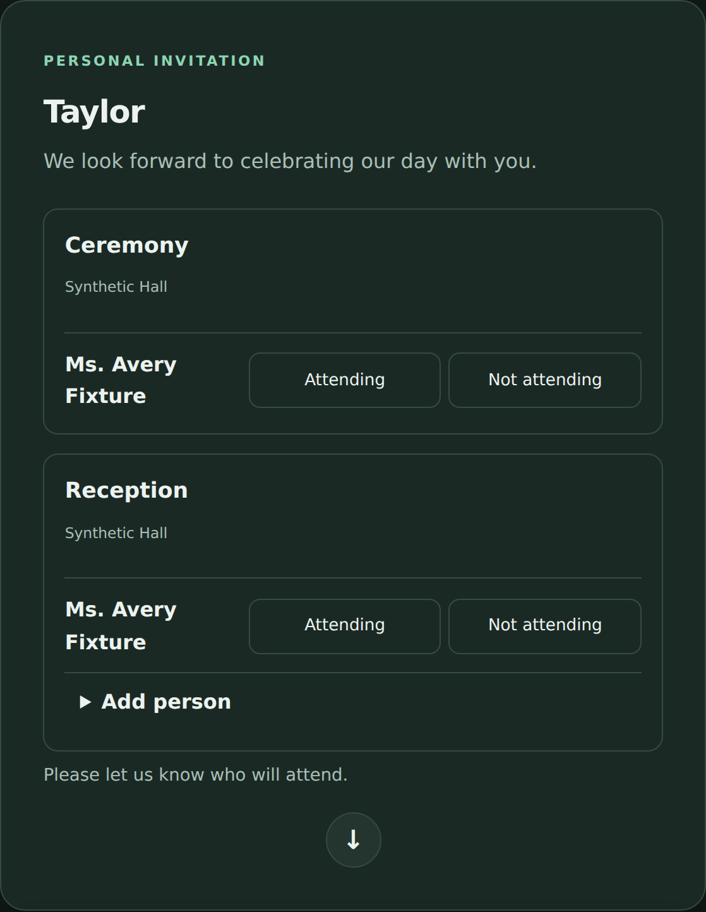
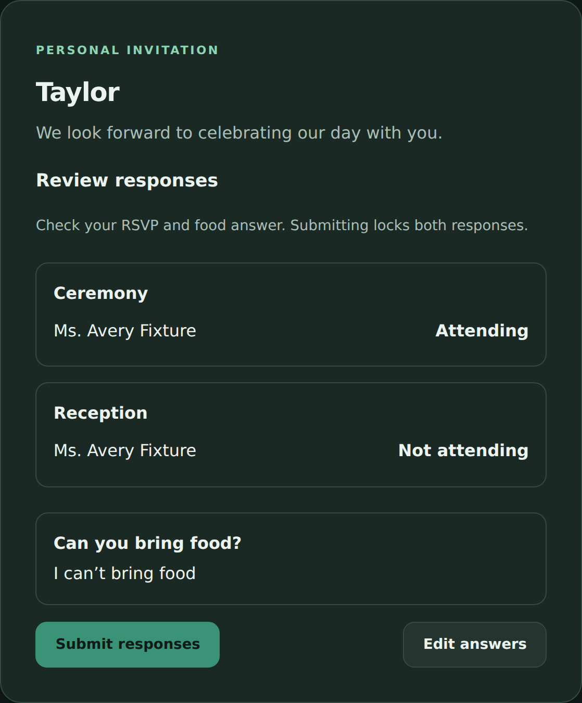

# Replying to an invitation

Open the private invitation link your organizer sent you. You do not need an administrator account. Without a valid invitation, the page asks for a code and does not reveal event details. Keep the link private: it gives access to your household’s invitation.

## Attendance

1. Review your household’s sessions. The link opens in your household’s language. If you choose another language, this browser remembers it for this invitation.
2. Answer separately for each invited person and session using the inline choices. Adults appear before children.

   
3. Use the down arrow after RSVP to check for missing attendance answers and move to the next section. When **Food coordination** asks for a Yes or No, its down arrow checks that answer before continuing.
4. Open **RSVP comment** below the questions if you want to share dietary requirements or another message.
5. When RSVP and the food question both need an answer, choose **Review responses**, check both answers, then choose **Submit responses** to save and lock them together. On phones, the review and submit actions stay in the bottom footer. Use **Edit answers** to return to your choices.

   

When only RSVP needs an answer, use **Review RSVP** and **Confirm RSVP**. Your household comment is visible to your household and authorized administrators.

Before submitting, **Add person** lets you add someone to your own household, including whether they are a child. They inherit its session invitations; review their replies too. If you have already confirmed or the response window has closed, contact the organizer.

Each session shows its welcome message, address and local time. The map thumbnail and **Map & directions** caption open the venue’s directions. Maps need an internet connection.

## Food

If offered, choose **I can bring food** or **I can’t bring food**. When RSVP is due too, include both answers in **Submit responses**. When only the food question needs an answer, select **Confirm food answer**. You can change your choice before saving. The saved answer records your household’s interest.

When the organizer opens food choices, use your original invitation link. If your household has food access, has confirmed attendance and answered Yes, **Your RSVP** shows who is attending each session above **Choose food to bring**. The menu groups available items by category.

- Check the item’s guest note, total need and remaining availability. Set the quantity, then click its box to reserve that quantity; click again to remove it while editing is allowed. Changing the quantity of a selected item updates its reservation immediately.
- A **Food Group** reserves one unit of **every listed member** together. If any member is unavailable, the group cannot be selected.
- Guest notes appear beside the quantity information. Open details for recipes. An unavailable item may no longer appear.
- Choose **Review food selections**, check names and quantities, then select **Confirm food choices**. **Back to edit** keeps your reservations so you can adjust them.
- If confirmation fails, check the message beside **Confirm food choices** and try again.

Reopen the same invitation link to see the confirmed items and quantities under **You’re bringing**. The summary includes any available **Recipe** links, with **Print** and **Close** controls.

Choosing No cannot remove existing commitments. If your attendance or food choices are locked, contact the organizer for help changing them.

## Appearance and access

If the organizer enables it, use the light/dark toggle. Otherwise their chosen appearance applies. A configured invitation photo appears only after authorized access, not on the code-entry page.

If your link fails, check that it is complete. The event may be unpublished or your invitation may need review. Ask the organizer rather than using someone else’s link.

[All user guides](README.md)

## Invitation appearance for organizers

Under **Settings → Invitations → Landing page**, organizers can replace a private background JPEG, adjust its crop/position, colors, darkening and box opacity, and open one collapsible Preview for the selected Wide or Phone mode before saving. A new JPEG must be at most 1.4 MB. It is prepared in the browser, reduced to at most 2400 px on its longest edge and re-encoded to remove metadata; the displayed dimensions/file size describe the stored image. Uploaded photos stay in private event settings and application backups, not the public website files. Authorized recipients can view/save the photo they receive; private access does not prevent an invited person from sharing it.

Save does not publish the event. Reset appearance keeps the photo; Remove photo removes it only when saved. Colors are configured separately for dark/light appearance. Existing settings and the current photo remain intact until explicitly saved.

Invitations keeps independent **Wide** and **Phone** settings within **Landing page → Invitation appearance**. The mode selector switches the actual settings and their retained draft. The read view shows five compact summary rows. Photo dimensions, file size and crop are under Details. A single collapsible Preview shows the selected mode. In **Guest appearance**, **Show titles** sits below **Show repeated surname beside each guest**. Turn on **Show titles** to choose the invitation languages that display titles. Turning it off keeps the language choices for later. Titles use the language the guest is viewing. A guest’s **Name display** override takes precedence. Status messages uses the same visible heading, Wide/Phone selector and top-right pencil, with independent mode drafts and Save/Cancel. Guest rendering follows the current viewport.
