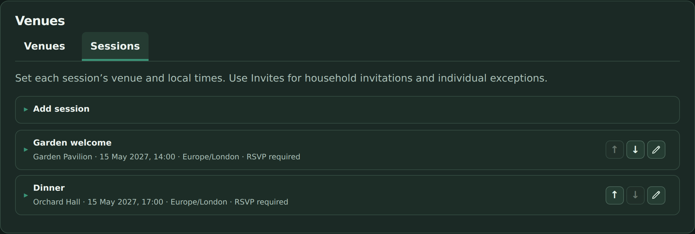
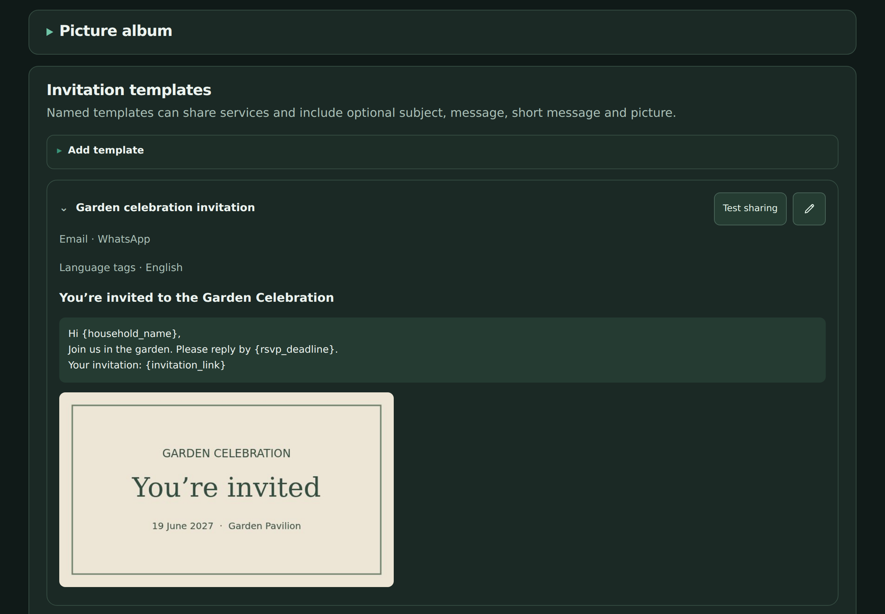
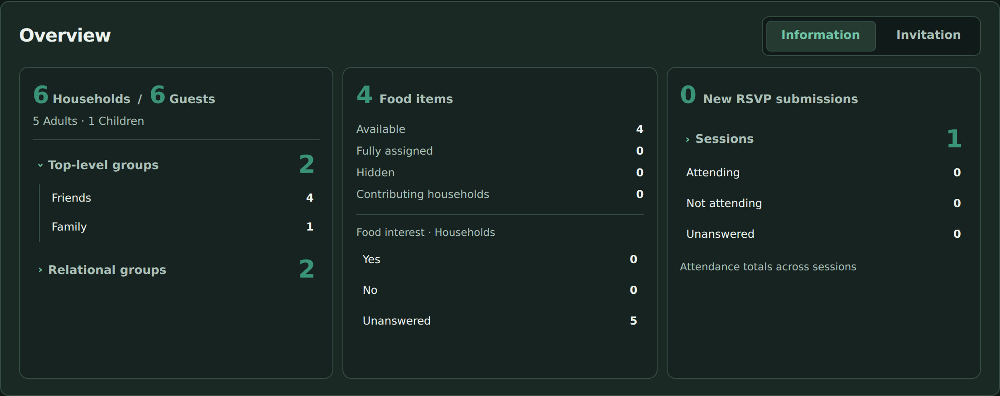
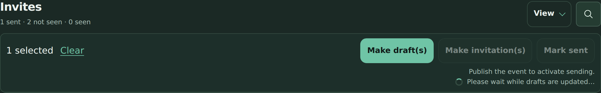

# Households and invitations

## People and household details

Open Households to browse the nested list. Expand a household to see its guests. Household details keeps its primary-contact name/number/service and conditional Food caption visible collapsed or expanded. Expanded reading shows unlabelled address/landline, group path and invited sessions; use the household pencil to edit those details. Save or Cancel returns to the summary.

The top-level and relational-group headers have order arrows, an add icon and a pencil. Guarded Delete is at the lower right of each group editor, opposite Save/Cancel. Household and individual guest editors use the same footer layout for Archive/Restore/Delete; archived records can be opened for Restore while their data fields stay read-only. A top-level add icon creates a relational group in that section. A relational-group add icon opens Add household with both groups selected. There is no separate Add household section above the list. Top-level editing requires Settings edit access; relational groups and households require Households edit access.

Existing shared relational groups retain their links and are marked Shared group. Renaming or reordering one applies wherever it appears. New relational groups belong to the selected top-level group. Delete requires an empty group, including no archived households; a top-level group must also have no scoped relational groups, and at least one top-level group must remain.

Show archived records sits beside Expand all / Collapse all. The combined Households/Guests statistics box in Invites also shows configured top-level and distinct relational-group counts.

Parent–child grouping, indentation and saved order are kept when browsing invitations. Use the order arrows where available. Archive unused records when you want to retain their history.

Allow food in Household details controls whether the household may participate in food selection. Its food commitments are managed in the Food area for that household or under the food item itself.

## Venues and sessions

A venue is a place. A session is an activity at a place and time. Several sessions can use the same venue.

Open **Home → Venues**. Use the **Venues** tab to add and order places.

Use the **Sessions** tab to add and arrange activities. Check each session’s venue and local time. Open the session editor and select **Manage households**. Use **Invitations** to add or remove household invitations in bulk. The **Food** tab shows saved interest and food access for households with an invited guest. Use **Manage food access** to edit the event-wide list after saving or cancelling any invitation edits. **Households → Household details** provides session checkboxes and **Individual guest exceptions**. Save applies the household details and changed invitations together.

## Replies

Open Households → Household details for session invitations; use Invites for RSVP management. Review which sessions each household and individual is invited to. Use the provided correction/reopening actions when a guest needs help changing a submitted reply; keep a clear reason for the change.

## Preview the guest experience

Use the eye icon in the administrator toolbar to preview the landing page. In **Invites**, use **Preview** beside a household to see its invitation before publishing. Preview requires a signed-in administrator with view access to Households, Invites and Venues, plus Food when that feature is enabled. Test replies, food selections and added household guests stay in that preview only and disappear when you reload or close the tab. Preview guest additions never change the real guest list.

While the event is unpublished, you can keep planning and previewing invitations. New invitation codes are issued when you publish. Previously issued codes stay reserved. Published Invites rows hide the preview eye and household pencil. Prepare drafts from the Invites toolbar, then use the copy controls or expand a household to review its delivery. Sent remains a separate manual confirmation.

## Set up invitation templates

Open **Settings → Templates → Add template** and enter a name. Use the **Service** dropdown to select one or more of Email, Messages, WhatsApp, SMS and Manual. Use **Options** to select Subject, Message, Short Message and Picture as needed. Short Message is a single-line field for SMS transport. When it is off, SMS uses Message. SMS transport is text-only. Turning off an option hides its fields and placeholder help while retaining their wording. Use **Language tags** to select the household languages this template should match. Templates saved before language tags were introduced start with no tags. Open a saved template by selecting its title. The pencil opens the template for editing so you can save the appropriate tags. Deleting a template preserves existing delivery snapshots and history. An invitation prepared from a template records the exact template revision and shares stored picture bytes with other invitations using the same picture. Each household keeps its rendered wording, RSVP link, recipient and edits.

To test on your phone while the event remains unpublished, use **Test sharing** beside a saved template, or open its pencil to test an unsaved picture/text draft. The dialog uses example names and this installation's landing-page preview link (`#guest-preview=landing`), never a household invitation code. The landing preview retains its existing administrator sign-in and permission requirements. Choose yourself in WhatsApp or Messenger and check the picture/text/link. It creates no invitation or delivery record and does not mark anything Sent. Unsaved picture/text edits can be tested before Save.

Expand **Picture album** above **Invitation templates** to manage shared pictures. An optional **Invitation picture** accepts a JPEG under 1.4 MB. The application re-encodes it, removes embedded metadata and limits it to 2400 pixels. It is stored privately with the template and copied into new drafts for services that support pictures. You can replace or remove the picture in a draft. Saving a changed template does not change existing drafts or sent history. Cancel discards your picture edit; a failed save retains it for retry.

Use `{invitation_link}` in the message. You can also use `{household_name}` and `{event_name}`. New drafts fill these in automatically. For an individual draft, choose a named template or start with the invitation link. For bulk generation, language tags control which templates are eligible.

## Invites overview

**Home → Main** opens the Overview and Invites list. The Overview starts on **Information**, with Households and Guests in one card, followed by Food items and New RSVP submissions. The **Invitation** tab contains Invites, Services and Language. **View** and **Search** are beside the Invites heading. Select households to see **Make draft(s)**, **Make invitation(s)** and **Mark sent**.

Keep **Main** open to see qualifying invitation visits, RSVP responses, and food changes update the Overview totals. You can still click any count that filters Invites. Live updates keep the current filters, selection, and open edits in place.

Open **Settings → Interface → Overview appearance** to select which cards appear. Drag cards within their tab or use **Move up** and **Move down**. Select **Save** to apply the layout to your account on every screen size. **Reset to defaults** restores the starting order and visibility after saving. Switching tabs preserves active filters. Hiding a card in Settings clears its filters.

In **Overview → Invitation → Invites**, click **No drafts**, **Review**, **Ready**, **Sent**, **Not seen**, **Seen**, **Waiting Reply** or **Replied** to filter the list. Click the active filter again to clear it. **No drafts** shows households without a current delivery. **Review** shows drafts. A household can have a sent invitation and a new reminder draft. In **New RSVP submissions**, expand **Sessions** and select a session to scope attendance counts and the matching households. Select it again to return to all sessions. Click **Attending**, **Not attending** or **Unanswered** to filter by those responses. A household with mixed answers can match more than one attendance filter.

Use the clickable **Top-level groups** and **Relational groups** in the Households card to narrow the list. **Top-level groups** starts expanded. A relational parent includes its descendants. Multiple choices within a tree are combined, and the two trees can be used together. Click an active choice again to clear it. Select one or more rows in **Language** or **Services** to narrow the list. Deselect the last choice to show all households that match the other filters. Click the **Search** icon beside **View** to search household and recipient details. Click the icon again, choose **×**, or press **Escape** to close the field and clear the search.

Invites lists active households containing guests. Under **Settings → Interface → Invites appearance**, choose **Group by → None**, **Relational group** or **Service** to arrange the list. Relational grouping follows the order in Households. Service grouping uses Messages, Email, WhatsApp, SMS and None. Messages is the default mobile route when no service was chosen. SMS retains an explicit SMS choice, and None uses templates tagged Manual.

In **Invites appearance → Rows**, choose one or two rows independently for narrow and wide screens. The defaults are one row below 1024 CSS pixels and two rows at 1024 CSS pixels and wider. Use **1 Row** or **2 Row** in **View** to switch the current view. Crossing the width breakpoint reapplies the saved layout. One row puts optional details in separate columns. Two rows put each secondary detail under its main field.

Use **Invites appearance → Default shown fields** for separate defaults in both layouts. Household, Service and Invitation stay visible. In Rows 1, optional fields include Household info, Recipient, Seen, RSVP, RSVP info and Food. The Seen column shows Yes or No. Rows 2 always shows the Household, Service and Invitation details with optional RSVP and Food pairs. Changes made in the **View** menu apply to the current view. Returning to Rows 1 restores its temporary choices. Returning to Rows 2 restores its saved column defaults. Use the **Interface** pencil to edit grouping, row layout and field defaults under **Invites appearance**, then choose **Save** or **Cancel**. Saved choices follow the administrator account. A failed save keeps the edit for retry.

Click the **Service** chip to copy the current recipient number or email. Click **Review** to open the household’s **Invitation → Drafts**. Check the details and use **Edit delivery** if needed. **Make invitation(s)** resolves the current RSVP link and moves an eligible draft to Ready on a published event. The **Invitation** chip copies a valid Ready invitation. For invitations with a picture, the chip tries to copy the picture and text together and falls back to text if necessary. Click **Text** to copy just the message and RSVP link. Check the caption and RSVP link in the receiving app.

Expand a household to open **RSVP** or **Invitation**. Under **Invitation**, **Current invitation(s)** shows the prepared or sent invitation and **Drafts** contains messages still being prepared. **Delivery logs** records sends with the time, administrator, service and subject where available. Expand a send to review its saved message and picture when available. **Change to Draft** returns a Ready invitation to Review and keeps its saved details. When no overview or list filter is active, **Inactive households** opens archived or guestless household histories when available. Session invitations are in Household details. The Food summary filters by interest in either food stage when Food is enabled and you have access.

In Overview, **Sent** counts recorded sends. **Not seen** covers Ready and sent invitations without a qualifying visit. **Seen** includes households with a qualifying visit, even before sending is recorded. The summary beneath **Invites** shows these counts for the filtered list. In **2 Row** view, a Ready or sent invitation shows **Not seen** under its status until a qualifying visit, then displays the latest visit date and time.

Expand a household to see **Last sent**, its first and most recent invitation visits, and its qualifying visit count. Opening the household or returning to Main refreshes these figures and the row’s visit label. **Invitation opened** in Logs records link loads, grouped within 15 minutes. RSVP and Sent status are managed separately.

Drafts can be prepared while unpublished. They use `{invitation_link}` until a link can be resolved. Preparing a Ready invitation, opening a messaging app from a delivery record and recording sending require a published event. Use Delete in an eligible saved draft’s footer or editor to retire it from the active list while keeping its audit history. A reminder is a separate draft.

## Make and send bulk invites

Check households at the far right. The counter shows selected households over visible eligible households. The header checkbox selects or clears the visible selection. Use **Clear** beside the batch buttons to clear the selection. Hiding a row clears its selection.

1. Choose **Make draft(s)**. Each selected household with no current delivery and exactly one matching service and language template gets a draft. A selected Ready invitation returns to Draft with its saved details. New and returned drafts are available under **Review**. The result reports missing or ambiguous template matches.
2. Choose **Review**, check the drafts you want to prepare and use **Make invitation(s)**. You can also open a draft and do this individually. Resolve any missing recipient, template or RSVP link details before continuing.
3. Choose **Ready** and copy the recipient with the **Service** chip. Copy the invitation with the **Invitation** chip or use **Text** to copy the message alone. Then check the picture, caption and RSVP link in the intended chat before sending.
4. Back in RSVP Manager, check the Ready households you sent to and choose **Mark sent** to record your confirmation.

Invites shows **Recording…** until the database confirms. You can keep searching, copying invitations, and marking other households sent while the queue runs in the open tab. If a row shows **Retry**, it checks the saved invitation first and records it only if needed. Retry only records the confirmation in RSVP Manager.

Draft and invitation preparation show a spinner and progress message beneath the batch buttons. The result or error appears in the same place. Before publication, the toolbar explains that publishing activates sending.

With Apple Shortcuts enabled, open **Invites → iPhone Shortcuts** in its own box above the invitation list to review Ready WhatsApp invitations and select a batch. Creating a batch requires a published event, a trusted HTTPS website and API, and sending permission. Continue the review and launch steps in that box. Native Runner device acceptance remains pending. Sharing or preparing a batch leaves Sent confirmation to the organizer.

## Send an invitation or reminder from Households

Open the household’s delivery panel in **Households** for these sharing and confirmation options.

1. Prepare a delivery draft and check the recipient, message and private link.
2. Save it as ready when it is correct.
3. Use **Share invitation** to review the recipient/message, then tap **Share invitation** in the dialog to open your system share sheet. Choose an available app and the displayed recipient. Alternatively, use the existing Mail, Messages or WhatsApp handoff.
4. Review it in that app and tap Send.
5. Return to RSVP Manager and record that you sent it.

A successful system share handoff adds a separate **Share handoff completed** entry under invitation activity in the administration log. This is the browser’s report of a handoff, not proof of sending or delivery. Cancelling does not add a handoff entry. If logging fails after sharing, use **Retry logging**; it records the same handoff without sharing again. **Record as sent** remains your manual confirmation.

The native share sheet requires HTTPS and browser/device support. Its destinations depend on installed apps; Apple Messages handles iMessage/SMS according to your device configuration. The website cannot identify the chosen app or recipient. Note the actual app when recording sending; use Manual delivery for apps without a dedicated channel, such as Messenger. Unsupported browsers offer **Copy message**.

For a draft with a picture, the share dialog previews it and offers **Share picture and text**, **Share picture**, and **Copy message**. Some Apple/app combinations accept only one part of a combined share. If the picture or text is missing in WhatsApp or Messenger, share the picture separately, copy the message and paste it into the destination app. Keep the invitation link in the message and check both before sending. Direct Mail/Messages/WhatsApp composer links carry text only; use the native share dialog for a picture. The website cannot confirm which parts the receiving app retained.

Pictures are included in application backups and private saved delivery snapshots. Full backup files still have the existing size limit; pictures and repeated delivery history count toward it. Actual iPhone/iPad WhatsApp and Messenger behavior needs device acceptance. This feature does not publish an event or mark a message Sent.

Opening an app does not send the message or mark it as sent. The delivery log records your manual confirmation; it does not provide provider delivery or read receipts.

A reminder is a new draft. It does not change the original sending record.

Editing invitations and sending them are separate permissions. Someone may be allowed to prepare drafts without sending, or send a prepared invitation without editing it.

In **Invites**, expand a household to see **RSVP** and the **Invitation** submenu. Session invitations are in **Households → Household details**, using the household’s Save/Cancel controls. Individual guest exceptions retain Follow household / Invited / Not invited, and RSVP history protects invitation changes. After publication, the **Invitation** chip includes the current private RSVP link for a valid Ready invitation.

## Guest and household contact details

Use a guest’s pencil to enter their Phone, Mobile and Email. Choose Email, SMS or WhatsApp as their preferred method, or leave it unspecified. SMS and WhatsApp use the guest’s Mobile number.

Under **Household details**, use **Add Contact** to choose an active adult in your household or from the guest list, or add a contact separately. Save the household to apply the choice. New invitation drafts can use the primary guest’s current details. The household itself still has a Landline and Postal address.

Guest lists show adults first, then children, using saved manual order within each section and alphabetical order where no position is saved. Row arrows move people within their adult/child section; changing status or adding a person appends them to the appropriate section. Admin, invitation, review and confirmed lists use the same policy. Household arrows reorder siblings, including child households.

## Delete an unused archived record

**Delete** is available on household and guest rows while the event is unpublished. Once published, archive a record first and turn on **Show archived records** to find **Delete** next to **Restore**. Move or delete a household’s guests and child households first. Records with dependent activity, such as RSVP history or delivery records, must stay archived. Retired codes stay reserved and administration log entries are retained.

[All user guides](README.md)

## Guest RSVP comments

Guests can add one optional household comment while reviewing attendance, for example dietary requirements. Find the latest comment under **Invites → household → RSVP**. Confirmation stores it with the immutable submission; organizer reopening allows a new submission without changing the old comment. It is separate from internal household notes and is included in full application backups.

## Food-interest follow-up

With Food enabled and Food View permission, click **Yes**, **No** or **Unanswered** under Food interest in the **Food items** statistics box to filter Invites. Click the active choice again to clear it. Search, other filters and household hierarchy order are retained. This summary is available during both Collect interest and Choose food. Each household’s row shows its stored answer. These states are independent of RSVP and delivery. The Food items summary counts active households with active guests. Food reservations and access to the detailed list are managed separately.

## Placeholder categories and correction

Settings → Placeholders and the field's {…} help use category tabs and search. Field help offers only tokens supported by that field. Choose Event, Household, Venue or another available category; there is no context dropdown.

If a template identifies a retired `{invite-deadline}` token, choose its explicit replacement with `{rsvp_deadline}`. A signed offset such as `:+4` is retained. This changes only the current draft; Save applies it and Cancel discards it. Stored templates are not rewritten automatically, and unsupported tokens remain rejected.
