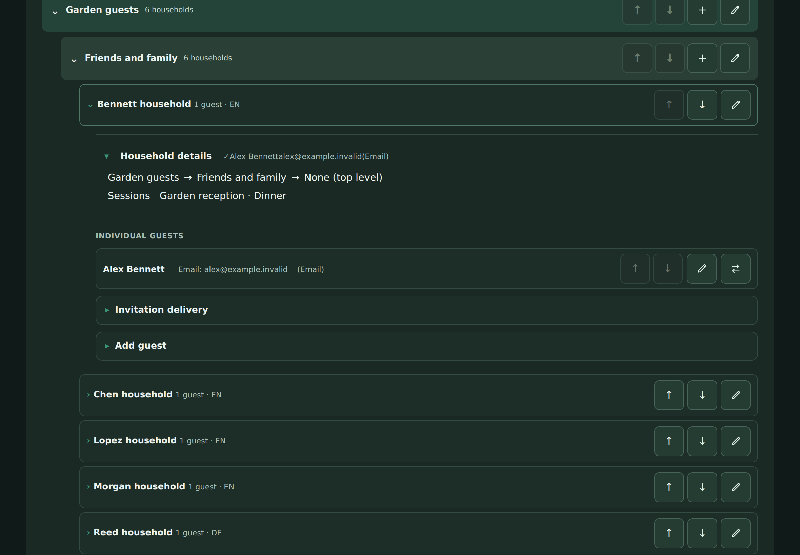
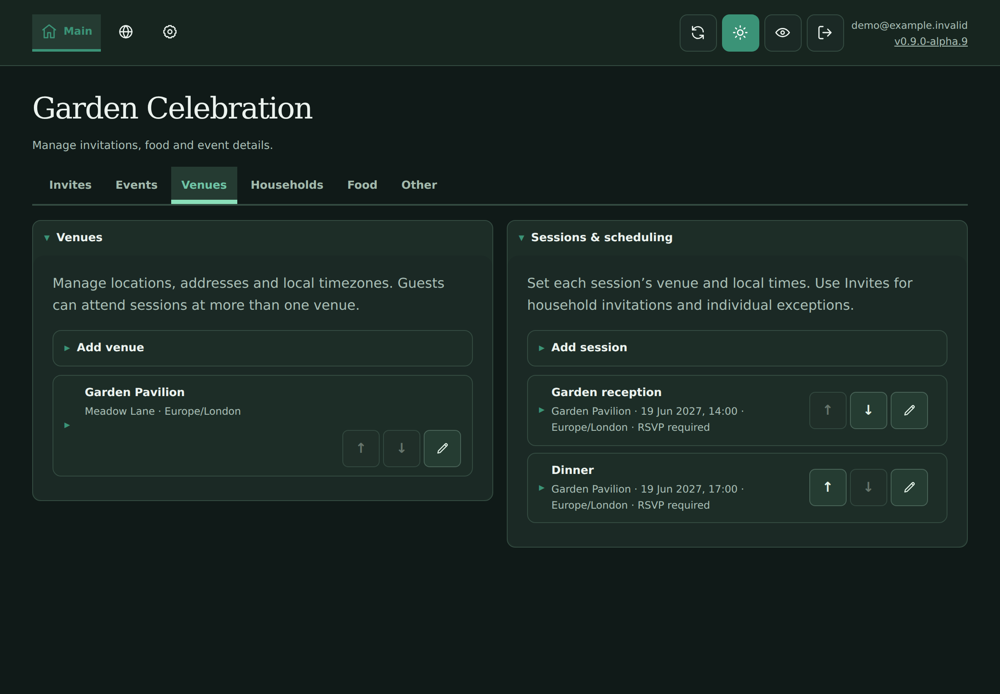

# Households and invitations

## People and household details

Open Households to browse the nested list. Expand a household to see its guests. Household details keeps its primary-contact name/number/service and conditional Food caption visible collapsed or expanded. Expanded reading shows unlabelled address/landline, group path and invited sessions; use the household pencil to edit those details. Save or Cancel returns to the summary.

The top-level and relational-group headers have order arrows, an add icon and a pencil. Guarded Delete is at the lower right of each group editor, opposite Save/Cancel. Household and individual guest editors use the same footer layout for Archive/Restore/Delete; archived records can be opened for Restore while their data fields stay read-only. A top-level add icon creates a relational group in that section. A relational-group add icon opens Add household with both groups selected. There is no separate Add household section above the list. Top-level editing requires Settings edit access; relational groups and households require Households edit access.

Existing shared relational groups retain their links and are marked Shared group. Renaming or reordering one applies wherever it appears. New relational groups belong to the selected top-level group. Delete requires an empty group, including no archived households; a top-level group must also have no scoped relational groups, and at least one top-level group must remain.

Show archived records sits beside Expand all / Collapse all. The combined Households/Guests statistics box in Invites also shows configured top-level and distinct relational-group counts.

Parent–child grouping, indentation and saved order are kept when browsing invitations. Use the order arrows where available. Archive unused records when you want to retain their history.

Allow food in Household details controls whether the household may participate in food selection. Its food commitments are managed in the Food area for that household or under the food item itself.

## Venues and sessions

A venue is a place. A session is an activity at a place and time. Several sessions can use the same venue.

Use Venues to create and order places and sessions. Check each session’s venue and local time carefully. Manage households on a session lets you add or remove household invitations in bulk. Households → Household details provides session checkboxes and a collapsed Individual guest exceptions section. Save applies the household details and changed invitations together.

On wide screens, the Venues and Sessions & scheduling boxes appear side by side. Opening an editor or Add venue/session expands that box across the row; reading views return to columns when editing closes. Narrower screens stack the boxes.

## Replies

Open Households → Household details for session invitations; use Invites for RSVP management. Review which sessions each household and individual is invited to. Use the provided correction/reopening actions when a guest needs help changing a submitted reply; keep a clear reason for the change.

## Preview the guest experience

Use the eye icon in the administrator toolbar to preview the landing page. In **Invites**, use **Preview** beside a household to see its invitation before publishing. Preview requires a signed-in administrator with view access to Households, Invites and Venues, plus Food when that feature is enabled. Test replies, food selections and added household guests stay in that preview only and disappear when you reload or close the tab. Preview guest additions never change the real guest list.

While the event is unpublished, you can keep planning and previewing invitations. New invitation codes are issued when you publish. Previously issued codes stay reserved. Published Invites rows hide the preview eye and household pencil. Prepare drafts from the Invites toolbar, then use the copy controls or expand a household to review its delivery. Sent remains a separate manual confirmation.

## Set up invitation templates

Open **Settings → Templates → Add template** and enter a name. Use the **Service** dropdown to select one or more of Email, Messages, WhatsApp, SMS and Manual. Use **Options** to select Subject, Message, Short Message and Picture as needed. Short Message is a single-line field for SMS transport. When it is off, SMS uses Message. SMS transport is text-only. Turning off an option hides its fields and placeholder help while retaining their wording. Use **Language tags** to select the household languages this template should match. Templates saved before language tags were introduced start with no tags. Open a saved template by selecting its title. The pencil opens the template for editing so you can save the appropriate tags. Deleting a template preserves existing delivery snapshots and history.

To test on your phone while the event remains unpublished, use **Test sharing** beside a saved template, or open its pencil to test an unsaved picture/text draft. The dialog uses example names and this installation's landing-page preview link (`#guest-preview=landing`), never a household invitation code. The landing preview retains its existing administrator sign-in and permission requirements. Choose yourself in WhatsApp or Messenger and check the picture/text/link. It creates no invitation or delivery record and does not mark anything Sent. Unsaved picture/text edits can be tested before Save.

Expand **Picture album** above **Invitation templates** to manage shared pictures. An optional **Invitation picture** accepts a JPEG under 1.4 MB. The application re-encodes it, removes embedded metadata and limits it to 2400 pixels. It is stored privately with the template and copied into new drafts for services that support pictures. You can replace or remove the picture in a draft. Saving a changed template does not change existing drafts or sent history. Cancel discards your picture edit; a failed save retains it for retry.

Use `{invitation_link}` in the message. You can also use `{household_name}` and `{event_name}`. New drafts fill these in automatically. For an individual draft, choose a named template or start with the invitation link. For bulk generation, language tags control which templates are eligible.

## Invites overview

**Main → Invites** shows four overview boxes for Households and Guests, RSVP submissions, Food items and invitation status. The **Sorting** box below the overview contains **Rows**, **Shown fields**, **Group**, **Language** and **Services**. The invitation list sits under Sorting. Its toolbar shows **Generate Drafts**, **Mark ready**, **Make draft**, **Mark Sent** and **Search**, in that order.

Click **All**, **Not sent**, **Needs draft**, **Ready**, **Marked sent**, **Awaiting reply** or **Replied** in the Invites statistics box to filter the list. Counts are per household. **Needs draft** shows households with no current delivery. **Not sent** also includes prepared invitations with no recorded Sent history. Status categories can overlap when a reminder is being prepared. The latest draft/attempt and last recorded sent date remain separate from RSVP status. A reopened RSVP is awaiting a new response even if earlier responses remain in history.

Invites lists active households containing guests. Under **Settings → Interface → Invites appearance**, set **Group by** to **None**, **Relational group** or **Service**. Both grouped layouts put each group in its own outline box. Relational grouping follows Households: configured top-level order, relational-group order, then parents before their descendants with manual sibling ordering. Empty grouping households are omitted while preserving their descendants' place. Service grouping uses Messages, Email, WhatsApp, SMS and None; empty groups are hidden.

Open **Search** to the right of **Mark Sent** to search household or recipient details. **Group**, **Language** and **Services** accept multiple choices. Use **All** to select every choice or **None** to clear them before picking individual values. Messages is the default mobile route when no service was chosen; SMS retains an explicit SMS choice, and None uses templates tagged Manual.

**Rows → 1** puts the selected details in separate columns. **Rows → 2** puts them beneath their main household, recipient, invitation or RSVP line. Household, Service and Invitation always stay visible. In Rows 1, **Shown fields** offers Household info, Recipient, Last sent, RSVP, RSVP info and Food. Rows 2 offers the paired RSVP column and Food; its Service/Recipient and Invitation/Last sent pairs stay visible. Household info contains guest count and language. The Service chip shows only the service name; Last sent and RSVP info show dates and response counts when those details exist in the visible list. In the two-row layout, secondary details follow their visible main field.

In **Invites appearance → Default shown fields**, choose separate defaults for **Rows 1** and **Rows 2**. Rows 1 lists eight individual fields. Service and Invitation are fixed on; Recipient, Last sent, RSVP, RSVP info and Food start enabled, and Household info starts off. Rows 2 shows whole column groups: Service with Recipient, Invitation with Last sent, RSVP with RSVP info, and Food. Household with its guest/language information, Service and Invitation are fixed on. RSVP and Food start enabled. Fixed columns have checked, disabled controls. Grouping and both sets of defaults share that box's pencil and **Save / Cancel**, independently of the other personal preferences. Saved choices follow your administrator account across devices. A failed save keeps the draft for retry.

Changes in **Shown fields** and **Rows** apply to the current view. Choosing Rows 2 resets Shown fields to its saved column groups, initially **All**. Each two-row choice shows or hides the whole upper/lower pair. Returning to Rows 1 restores your previous one-row selection, or your saved default fields if you have not changed it. Changes made in Rows 2 do not replace your one-row selection; saving defaults for one layout does not reset temporary choices in the other. Refreshing the data keeps the current view. Reloading the page restores your saved field defaults and starts with Rows 1; changing accounts also resets Rows to 1. These view controls do not change household selections or record sending.

Click the **Service** chip, such as WhatsApp or Email, to copy the current recipient number or email address. Choose **Review** to open a saved draft in **Current invitation**. Check the details, use **Edit delivery** if needed, then choose **Mark ready**. On a published event, the **Invitation** chip copies a valid Ready invitation and its RSVP link. For invitations with a picture, the chip tries combined picture-and-text copying and falls back to text when the browser cannot copy both. Your messaging app chooses what to paste. If it drops the caption, copy the wording from **Current invitation** separately and check the RSVP link before sending.

Expand a household to open **Current invitation** above **RSVP**. **Invitation delivery** opens separately and contains **Delivery history** with that household’s past attempts and sent snapshots. Use **Change to Draft** inside a Ready invitation to return it to review while keeping its saved details. In the **All** view, **Inactive households** opens archived or guestless household histories when any exist. RSVP management stays in the expanded row, and session invitation choices are in Household details. The Food column shows interest during Collect interest and item quantities during Choose food. A dash means unanswered or zero. The Food summary's clickable interest counts remain available in both stages when Food is enabled and you have Food View access.

Drafts can be prepared while unpublished, using `{invitation_link}` as a placeholder without issuing or releasing a code. Marking ready, opening messaging apps and recording sending remain publication gated. After publication, use **Review** and **Mark ready** on an existing draft. **Mark ready** resolves the current invitation link and uses the saved delivery details. Sent and cancelled records remain read-only; a reminder is a separate draft. Use Delete in a saved draft’s reading footer or editor to remove an unsent draft from active delivery lists. Its retired snapshot and audit history remain retained; Ready, Sent and handed-off records cannot be deleted this way. Notes/reasons and sending acknowledgements use the existing delivery history.

## Make and send bulk invites

Choose **Needs draft** in the overview and check households at the far right. The list header checkbox selects all visible eligible households. Hiding a row clears its selection.

1. Choose **Generate Drafts**. Each checked household with no current delivery and exactly one matching service and language template gets a draft. On a published event, a valid new draft becomes **Ready** in the same action when you have sending permission. Unpublished and incomplete drafts stay available for **Review**. The result reports missing or ambiguous template matches.
2. Open the **Ready** filter. For WhatsApp, copy the number with the **Service** chip, open the intended chat, then use the **Invitation** chip. Check the picture, full caption and RSVP link before pressing Send in WhatsApp.
3. Back in RSVP Manager, check the Ready households you sent to and choose **Mark Sent**. This records your confirmation. Already recorded deliveries retain their history.

Select existing drafts and use **Mark ready** in the toolbar to prepare the eligible selection. Use **Make draft** to return selected Ready invitations to review. For one household, use **Review → Current invitation → Mark ready** or **Change to Draft**. **Edit delivery** lets you correct the message or recipient. If the invitation link changes during preparation, reopen the draft to check the current link and try again.

With Apple Shortcuts enabled, open **Invites → iPhone Shortcuts** in its own box above the invitation list to review Ready WhatsApp invitations and select a batch. Creating a batch requires a published event, a trusted HTTPS website and API, and sending permission. Continue the review and launch steps in that box. Native Runner device acceptance remains pending. Sharing or preparing a batch leaves Sent confirmation to the organizer.

## Send an invitation or reminder from Households

Open the household’s delivery panel in **Households** for these sharing and confirmation options.

1. Prepare a delivery draft and check the recipient, message and private link.
2. Save it as ready when it is correct.
3. Use **Share invitation** to review the recipient/message, then tap **Share invitation** in the dialog to open your system share sheet. Choose an available app and the displayed recipient. Alternatively, use the existing Mail, Messages or WhatsApp handoff.
4. Review it in that app and tap Send.
5. Return to RSVP Manager and record that you sent it.

A successful system share handoff adds a separate **Share handoff completed** entry under invitation activity in the administration log. This is the browser’s report of a handoff, not proof of sending or delivery. Cancelling does not add a handoff entry. If logging fails after sharing, use **Retry logging**; it records the same handoff without sharing again. **Record as sent** remains your manual confirmation.

The native share sheet requires HTTPS and browser/device support. Its destinations depend on installed apps; Apple Messages handles iMessage/SMS according to your device configuration. The website cannot identify the chosen app or recipient. Note the actual app when recording sending; use Manual delivery for apps without a dedicated channel, such as Messenger. Unsupported browsers offer **Copy message**.

For a draft with a picture, the share dialog previews it and offers **Share picture and text**, **Share picture**, and **Copy message**. Some Apple/app combinations accept only one part of a combined share. If the picture or text is missing in WhatsApp or Messenger, share the picture separately, copy the message and paste it into the destination app. Keep the invitation link in the message and check both before sending. Direct Mail/Messages/WhatsApp composer links carry text only; use the native share dialog for a picture. The website cannot confirm which parts the receiving app retained.

Pictures are included in application backups and private saved delivery snapshots. Full backup files still have the existing size limit; pictures and repeated delivery history count toward it. Actual iPhone/iPad WhatsApp and Messenger behavior needs device acceptance. This feature does not publish an event or mark a message Sent.

Opening an app does not send the message or mark it as sent. The delivery log records your manual confirmation; it does not provide provider delivery or read receipts.

A reminder is a new draft. It does not change the original sending record.

Editing invitations and sending them are separate permissions. Someone may be allowed to prepare drafts without sending, or send a prepared invitation without editing it.

In **Invites**, expand a household to see **Current invitation**, **RSVP** and **Invitation delivery** in place. Session invitations are in **Households → Household details**, using the household’s Save/Cancel controls. Individual guest exceptions retain Follow household / Invited / Not invited, and RSVP history protects invitation changes. After publication, the **Invitation** chip includes the current private RSVP link for a valid Ready invitation.

## Guest and household contact details

Use a guest’s pencil to enter their Phone, Mobile and Email. Choose Email, SMS or WhatsApp as their preferred method, or leave it unspecified. SMS and WhatsApp use the guest’s Mobile number.

Under **Household details**, use **Add Contact** to choose an active adult in your household or from the guest list, or add a contact separately. Save the household to apply the choice. New invitation drafts can use the primary guest’s current details. The household itself still has a Landline and Postal address.

Guest lists show adults first, then children, using saved manual order within each section and alphabetical order where no position is saved. Row arrows move people within their adult/child section; changing status or adding a person appends them to the appropriate section. Admin, invitation, review and confirmed lists use the same policy. Household arrows reorder siblings, including child households.

## Delete an unused archived record

**Delete** is available on household and guest rows while the event is unpublished. Once published, archive a record first and turn on **Show archived records** to find **Delete** next to **Restore**. Move or delete a household’s guests and child households first. Records with dependent activity, such as RSVP history or delivery records, must stay archived. Retired codes stay reserved and administration log entries are retained.

[All user guides](README.md)

## Guest RSVP comments

Guests can add one optional household comment while reviewing attendance, for example dietary requirements. Find the latest comment under **Invites → household → RSVP**. Confirmation stores it with the immutable submission; organizer reopening allows a new submission without changing the old comment. It is separate from internal household notes and is included in full application backups.

## Food-interest follow-up

With Food enabled and Food View permission, click **Yes**, **No** or **Unanswered** under Food interest in the **Food items** statistics box to filter Invites. Click the active choice again to clear it, or choose **All** in the Invites statistics box to clear the status and Food-interest filters. Search, other filters and household hierarchy order are retained. This summary is available during both Collect interest and Choose food. Each household’s row shows its stored answer; these states are independent of RSVP and delivery. The Food items summary shows counts for active households with active guests, excluding archived and empty grouping households. Answering Yes alone does not reserve food or grant access to the detailed list.

## Placeholder categories and correction

Settings → Placeholders and the field's {…} help use category tabs and search. Field help offers only tokens supported by that field. Choose Event, Household, Venue or another available category; there is no context dropdown.

If a template identifies a retired `{invite-deadline}` token, choose its explicit replacement with `{rsvp_deadline}`. A signed offset such as `:+4` is retained. This changes only the current draft; Save applies it and Cancel discards it. Stored templates are not rewritten automatically, and unsupported tokens remain rejected.
