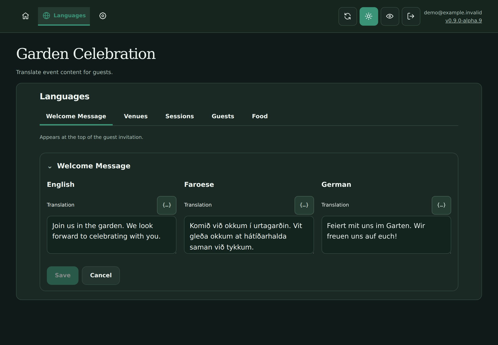
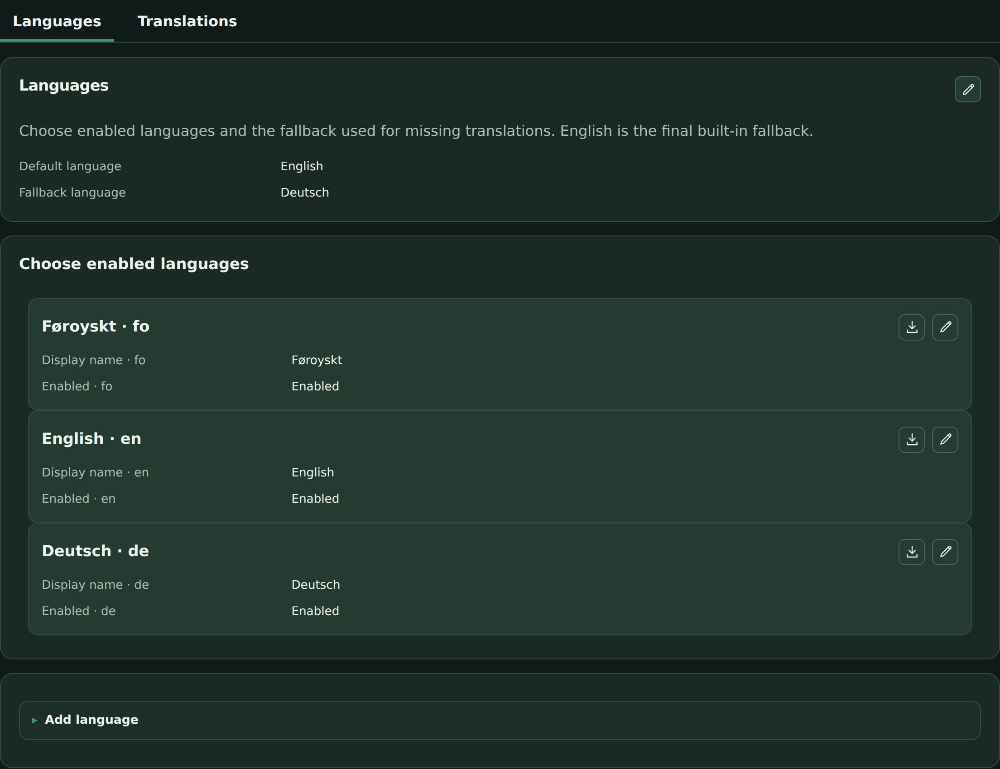

# Languages

There are three different language choices.

| I want to… | Where to go |
|---|---|
| Change the language I use to operate the app | Settings → Interface |
| Translate guest-facing event text | The Languages globe |
| Enable and order languages or choose defaults | Settings → Language → Languages |
| Edit shared interface wording | Settings → Language → Translations |

Open the **Settings → Interface** pencil to change your personal administrator language under **Appearance**. Save applies the choice to your account so it loads on other devices. Event wording is managed separately under **Translations**.

## Event content

The Languages globe groups text into Welcome Message, Venues, Sessions, Food and Guests. Food includes item names/Guest notes, categories and shared types. Choose the record you need; all enabled languages are shown together.

Venues, Sessions, Food items, Categories and Units appear as expandable record cards, with their pencils consistently in the top-right of each card. Open a card to read its translations; use its pencil to edit all enabled languages. Save/Cancel are below the fields. Saving one record retains drafts still open in other records. Search/tab changes ask before discarding unsaved translations. Failed saves retain input for retry.

The magnifying glass at the top-right opens search across record names, source text and saved translations. Close search with × or Escape. Food keeps its category filter. On wider screens language columns sit side by side; on phones they stack.

Use the globe beside the food item name in its editor, or the Languages page. There is no separate Language text link beside an item. Use the box’s pencil to change text; the appropriate translation permission is required.

English provides the source wording. Missing translations use the configured fallback, with English as the final built-in fallback.

## Guests: food text

**Languages globe → Guests → Food explanation** holds the translated explanation previously edited under Event settings → Features. Existing text is retained. **Guests → Food Interest Reply** configures the message displayed after a household saves Yes in Collect interest and when that invitation is reopened.

Use the card’s pencil and Save/Cancel. Both texts support the event’s enabled languages and need Languages Edit permission. Each text is limited to 6,000 characters per language; changing it does not change food access, answers, commitments or publication.

The reply accepts `{invite-deadline}` and calendar-day offsets such as `{invite-deadline:+5}` or `{invite-deadline:-2}` (up to 366 days). The date comes from the event’s **RSVP deadline**, using its timezone, then is displayed in the guest’s language. Preview uses the same renderer as the invitation. Unsupported placeholders are rejected.

Set **Reply when no deadline is set** without a date placeholder. Missing translations use the configured fallback and then English. If no custom fallback is configured, a translated message says more information will follow. Replies are plain text. Only a saved Yes in Collect interest shows this reply; No, Unanswered and Choose food do not.

## Placeholders

These `{placeholders}` are replaced with event/household values. They are specific to the message editor; they are not shared across every text field.

| Where | Placeholder | Replaced with |
|---|---|---|
| Settings → Templates | `{invitation_link}` | The household’s private invitation URL; required in a nonempty invitation message |
| Settings → Templates | `{event_name}` | Event name |
| Settings → Templates | `{household_name}` | Household name |
| Languages globe → Guests → Food Interest Reply | `{invite-deadline}` | The event’s RSVP deadline date in its timezone |
| Languages globe → Guests → Food Interest Reply | `{invite-deadline:+5}` | Five calendar days after that date |
| Languages globe → Guests → Food Interest Reply | `{invite-deadline:-2}` | Two calendar days before that date |

Food reply offsets accept -366 through +366 days. Without a deadline, the configured no-deadline reply is used. Do not put deadline placeholders in the no-deadline reply or invitation templates. Food Explanation accepts ordinary text. Shared interface wording has its own phrase-specific placeholders: retain exactly those shown for the selected phrase.

Press **{…}** beside an invitation-template Subject/Message, Food Interest Reply or a shared wording phrase containing placeholders. The help shows only that field’s supported tokens. **Insert** replaces the selected text or adds the token at the cursor; it updates the draft and preview without saving. Close the help with Close or Escape. Ordinary Food Explanation and the no-deadline reply do not support tokens. This table is the shared reference.

## Enabled languages and interface wording

Settings → Language → Languages controls the enabled languages and their order, along with the default and fallback choices. Use the arrows to reorder languages. Default-language settings and each language have a pencil in their card header. Open the appropriate card, then use Save or Cancel.

Settings → Language → Translations lets you choose a language, browse categories or search, and use a pencil to change shared wording. Save keeps an override; clearing an override allows the underlying wording/fallback to be used again.

CSV export downloads version 2 shared wording for the selected language (`rsvp-locales-v2-<language>.csv`). Each row identifies its format and exact catalog version. Import requires a complete export from the current catalog; older formats or a different catalog are rejected. Export a fresh file after a catalog update. This is not a backup of your guests or the complete event. Ask the installation owner to import reviewed wording.

[All user guides](README.md)

## Time display

**Settings → Interface → Date and time** offers personal date and clock formats with a live sample. Save applies the formats to dates and times displayed in the administrator interface. Sessions still use their venue time zones and scheduled times.
