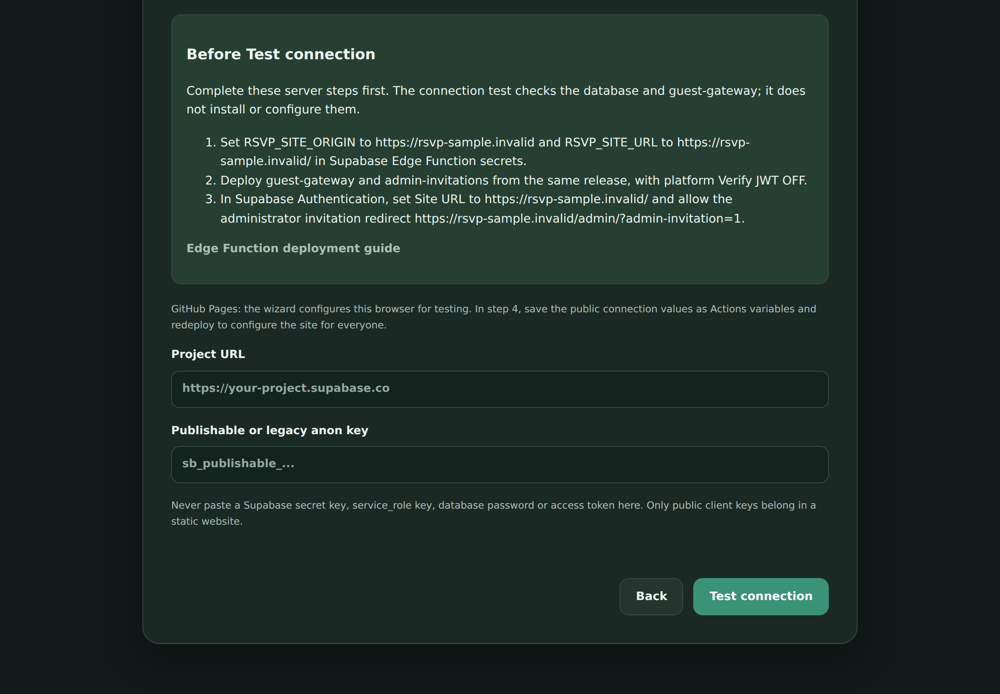

# Install with Supabase Studio

You can perform cloud setup in Supabase's browser Dashboard/Studio; the CLI is an optional alternative. Use the website, SQL installer and function code from the same RSVP Manager release. Studio-ready files are generated from the canonical modules and preserve their validation logic.

## Follow the wizard in this order

1. **Step 1 — Database choice:** choose New database → Cloud for a fresh project, or Existing database to preserve an installed event.
2. **Step 2 — Connection:** create the cloud project and install SQL once if empty, save the site secrets, deploy both functions with Verify JWT OFF, and configure Auth URLs. Only then enter the public URL/key and press Test connection. Complete sections 1–5 below before that test.
3. **Step 3 — Administrator:** create/confirm the first Auth user and grant first-administrator access using the wizard’s generated SQL; existing administrators sign in normally.
4. **Step 4 — Publish config:** configure the website for everyone. On GitHub Pages, save Actions variables and rerun deployment; direct static hosting uses the downloaded config.js.

The wizard’s temporary browser configuration is enough for its connection test. GitHub Actions variables configure the deployed site for all visitors; they do not replace Supabase secrets or deploy Edge Functions.

## Cloud project security options

When creating the cloud project, use these **Security options**:

| Option | Set to | Why |
|---|---|---|
| Enable Data API | ON | Website and Edge Function database calls require it. |
| Automatically expose new tables | OFF | The installer supplies explicit table/function grants. |
| Enable automatic RLS | ON | Protects future tables; the installer also enables RLS and creates the application policies. |

Keep `public` in the Data API exposed schemas; do not expose `app_private`. For an existing project, check Data API availability and schema exposure under **Integrations → Data API**. These settings do not publish the event. Do not add broad grants or disable RLS to fix a connection error.

## 1. Install the database once

For a new empty project, choose **Set up a new database** in the RSVP wizard, then run the complete release's `supabase/install.sql` in the project's **SQL Editor**. Never replay it over a populated installation. The wizard does not run privileged SQL itself.

The installer creates the current application schema, enables RLS, and runs in one transaction. It refuses an existing application schema. No previous-version migrations or retired tables are part of this installation. Keep table-level RLS enabled.

## 2. Set function secrets before deployment

Open **Edge Functions → Secrets** and save:

| Name | Root-hosted example | Subdirectory example |
|---|---|---|
| `RSVP_SITE_ORIGIN` | `https://events.example.org` | `https://events.example.org` |
| `RSVP_SITE_URL` | `https://events.example.org/` | `https://events.example.org/celebration/` |

The origin has no path or trailing slash; the full site URL includes the installation path and trailing slash. Supabase injects its own server credentials into hosted function runtimes. Do not paste server keys into function code, website files or browser configuration.

## 3. Deploy guest-gateway through the editor

1. Open **Edge Functions → Deploy a new function → Via Editor**.
2. Name the function exactly `guest-gateway`.
3. Open the release-matching `supabase/studio/guest-gateway.ts` and replace the editor's entire `index.ts` with its complete contents. This is a self-contained file: no shared-file imports need manual editing.
4. Click **Deploy function**.
5. Open the function's **Details** tab and set **Verify JWT** (sometimes labelled **Verify JWT with legacy secret**) to **OFF**, then save. Match this setting wherever it is also offered at initial deployment.

The [browser guide](StudioSetup.html) verifies both complete files against their release manifest and provides Copy controls. Do not paste only `supabase/functions/guest-gateway/index.ts`: that modular source imports shared files. The generated Studio files include those helpers. Maintainers regenerate them with `node tools/build-studio-functions.cjs` and verify them with `--check`.

## 4. Deploy admin-invitations

Repeat the same steps with function name `admin-invitations` and the complete `supabase/studio/admin-invitations.ts` file. Set its platform **Verify JWT** toggle to **OFF** too.

This matches `supabase/config.toml`. The guest handler validates invitation codes, payloads, origins and rate limits. The administrator handler separately validates the user through Supabase Auth and guarded membership/session RPCs. Turning off the platform's legacy JWT check does not remove those application checks.

Keep the same release's function code and generated source-hash manifest as your deployment record. Replacing editor contents with different code is a deployment change.

## 5. Configure Auth URLs, then test the connection

Before creating or inviting the first Auth user, open **Authentication → URL Configuration**. Set Site URL to the full installation URL and allow `<site URL>admin/?admin-invitation=1`. Configure email/SMTP for real invitation delivery.

Both functions and site secrets must be ready before the wizard’s step 2 connection test. That test probes the database and guest-gateway; it does not install SQL, save secrets or deploy code.

Both functions should appear in the Edge Functions list. In the built-in tester, send POST to `guest-gateway` with an `Origin` header matching `RSVP_SITE_ORIGIN`, `Content-Type: application/json`, and:

```json
{"action":"get_invitation_v2","args":{"p_code":"AAAAAAAA"}}
```

For a fresh unpublished project, HTTP 200 with JSON `null` is the expected private response. A POST of `{}` to `admin-invitations` without a signed-in administrator JWT should return HTTP 401 from the handler; this does not send an email.

Return to the wizard and retry **Test connection**. If a function reports **BOOT_ERROR**, check its code, Secrets and logs. **Invalid JWT** usually means the platform toggle is still on. **Origin not allowed** means the request Origin and configured origin differ; use the website's canonical origin, not its full URL or a redirect hostname.



## 6. Wizard step 3: the first administrator

In step 3, use the trusted companion or expand **Manual setup**. For manual setup, create and confirm the first Auth user under **Authentication → Users**, enter that account’s email and generate the first-administrator SQL. Run it in your private Supabase SQL Editor, then verify login in the wizard. The SQL checks for an empty, uninitialized application and a single matching confirmed Auth account. Existing installations use their administrator sign-in.

## 7. Wizard step 4: publish the browser configuration

Supply only the public project URL and publishable key through the wizard. Browser-local settings configure that browser only. For a selected-release GitHub Pages installation, open the website repository’s **Settings → Secrets and variables → Actions → Variables**, create `RSVP_SUPABASE_URL` from `supabaseUrl` and `RSVP_PUBLISHABLE_KEY` from `supabaseKey`, then rerun its deployment workflow. The generated Pages artifact supplies `js/config.js`; committing an extra file to the website repository does not configure that artifact. See [the full UI and CLI instructions](../INSTALL.md#configure-jsconfigjs-with-github-actions). Direct static-file installs can use the wizard's downloaded `js/config.js` instead.

Keep the event unpublished until you deliberately approve launch. Deploying functions and completing setup do not publish it.

## References

- [Supabase Dashboard function deployment](https://supabase.com/docs/guides/functions/quickstart-dashboard)
- [Function secrets](https://supabase.com/docs/guides/functions/secrets)
- [Dashboard JWT setting](https://supabase.com/kb/troubleshooting/edge-function-401-error-response)
